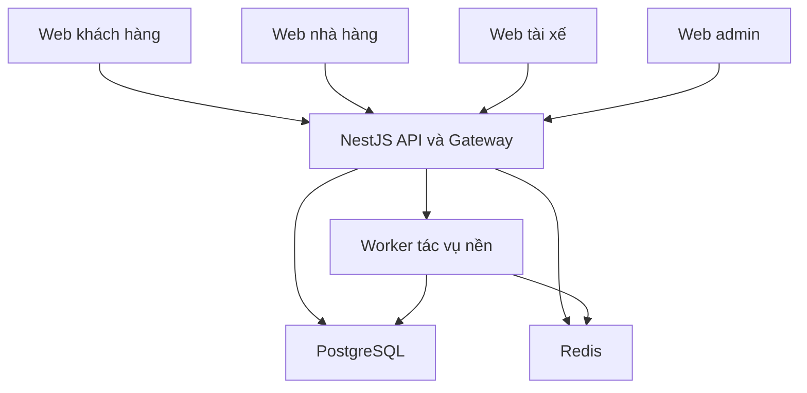
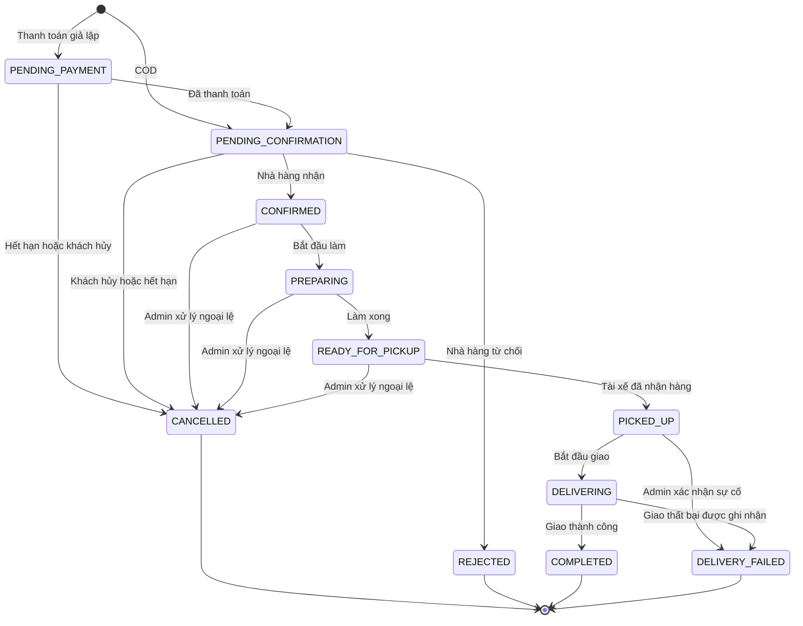
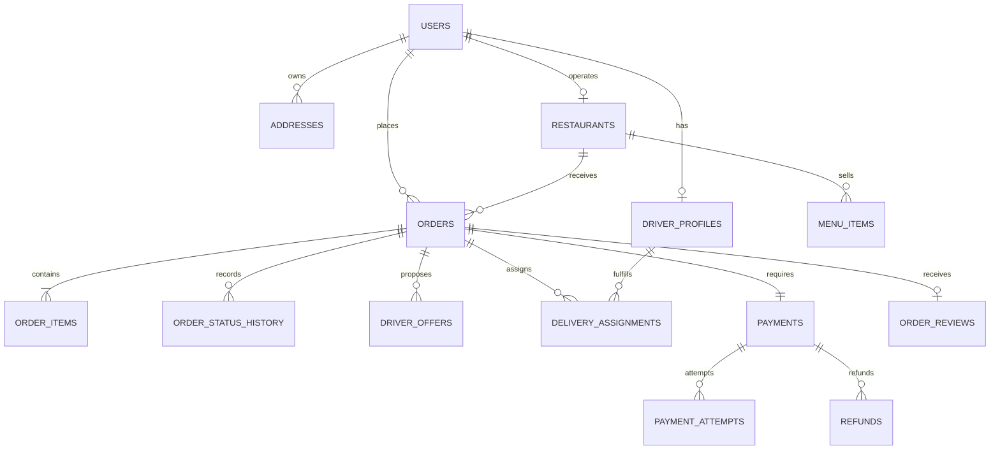

# dat-va-giao-do-an
Nguyễn Minh Đưc 2506022014
Nguyễn Trong Khang 2513022003
Nguyễn Gia Huy 2506022010

Yêu cầu đồ án: Hệ thống Đặt và Giao đồ ăn
1. Yêu cầu chức năng (Functional Requirements)
1.1. Khách hàng (Customer)
FR-1: Đăng ký/đăng nhập tài khoản
FR-2: Tìm kiếm, lọc nhà hàng (theo khu vực, loại món, đánh giá)
FR-3: Xem menu, thêm món vào giỏ hàng, đặt đơn
FR-4: Thanh toán đơn hàng (giả lập cổng thanh toán hoặc COD)
FR-5: Theo dõi trạng thái đơn hàng theo thời gian thực (real-time)
FR-6: Xem vị trí tài xế trên bản đồ trong lúc giao hàng
FR-7: Hủy đơn (trong điều kiện cho phép theo trạng thái)
FR-8: Đánh giá nhà hàng/tài xế sau khi hoàn tất đơn
FR-9: Xem lịch sử đơn hàng
1.2. Nhà hàng (Restaurant)
FR-10: Quản lý menu (thêm/sửa/xóa món, cập nhật tình trạng còn/hết hàng)
FR-11: Nhận thông báo đơn hàng mới theo thời gian thực
FR-12: Xác nhận hoặc từ chối đơn hàng
FR-13: Cập nhật trạng thái chế biến (đang làm → sẵn sàng giao)
FR-14: Xem báo cáo doanh thu, lịch sử đối soát
1.3. Tài xế (Driver)
FR-15: Bật/tắt trạng thái sẵn sàng nhận đơn (online/offline)
FR-16: Nhận thông báo cuốc giao hàng, chấp nhận/từ chối trong thời gian giới hạn
FR-17: Cập nhật vị trí GPS liên tục trong lúc giao hàng
FR-18: Cập nhật trạng thái đơn (đã lấy hàng, đang giao, đã giao)
FR-19: Xem thu nhập theo ngày/kỳ đối soát
1.4. Hệ thống/Admin
FR-20: Quản lý người dùng, nhà hàng, tài xế (duyệt, khóa tài khoản)
FR-21: Thuật toán gán tài xế tự động dựa trên khoảng cách, trạng thái, tải công việc
FR-22: Quản lý toàn bộ vòng đời đơn hàng (state machine), ghi log lịch sử trạng thái
FR-23: Đối soát định kỳ (theo ngày/tuần): tính tiền trả cho nhà hàng, tài xế, hoa hồng hệ thống
FR-24: Xử lý khiếu nại, sai lệch số liệu đối soát (VD: COD không khớp)
FR-25: Gửi thông báo cho các bên liên quan (email/push/socket) khi trạng thái đơn thay đổi
FR-26: Thống kê, báo cáo tổng quan (doanh thu, số đơn, hiệu suất tài xế...)
2. Yêu cầu phi chức năng (Non-Functional Requirements)
Mã	Yêu cầu	Mô tả
NFR-1	Real-time	Cập nhật vị trí tài xế và trạng thái đơn phải hiển thị gần như tức thời (WebSocket, độ trễ < 5s)
NFR-2	Khả năng mở rộng	Kiến trúc module hóa, có thể tách thành microservices sau này
NFR-3	Bảo mật	Xác thực JWT, phân quyền theo vai trò (RBAC), mã hóa mật khẩu
NFR-4	Tính nhất quán dữ liệu	Giao dịch (transaction) đảm bảo khi tạo đơn, thanh toán, đối soát không bị mất mát/trùng lặp
NFR-5	Khả năng chịu lỗi	Xử lý khi tài xế mất kết nối, đơn không tìm được tài xế (timeout, retry, fallback)
NFR-6	Hiệu năng	Truy vấn tài xế gần nhất phải tối ưu (index địa lý, giới hạn bán kính tìm kiếm)
NFR-7	Khả năng kiểm thử/theo dõi	Log đầy đủ lịch sử trạng thái đơn để phục vụ audit và đối soát
NFR-8	UI/UX	Giao diện responsive, riêng biệt/rõ ràng cho từng vai trò (customer/restaurant/driver/admin)
3. Yêu cầu về phạm vi kỹ thuật (Scope/Constraints)
Ràng buộc công nghệ: dùng Postgres (có thể kèm PostGIS), Redis cho cache vị trí realtime, WebSocket cho tracking
Ràng buộc nghiệp vụ:
Một đơn hàng chỉ được gán cho 1 tài xế tại một thời điểm
Trạng thái đơn chỉ được chuyển theo đúng luồng đã định nghĩa (không nhảy cóc trạng thái)
Đối soát chỉ tính trên các đơn đã ở trạng thái COMPLETED
Giới hạn đồ án : không tích hợp cổng thanh toán thật (dùng giả lập), dùng OpenStreetMap/Leaflet thay vì Google Maps trả phí, không triển khai app mobile thật (có thể làm web responsive giả lập)

---

# Thiết kế chi tiết và kế hoạch triển khai cho nhóm

> Tài liệu này mở rộng yêu cầu gốc phía trên. Tên và MSSV được giữ nguyên theo file nhóm cung cấp. Các lựa chọn kiến trúc, thông số demo, giao diện, phân công và tiến độ dưới đây là **đề xuất thiết kế**, chưa phải mô tả phần mềm đã xây dựng hoặc kết quả đã kiểm thử.

## 4. Thành viên và cách sử dụng tài liệu

| Thành viên — giữ nguyên theo README gốc | MSSV |
| --- | --- |
| Nguyễn Minh Đưc | 2506022014 |
| Nguyễn Trong Khang | 2513022003 |
| Nguyễn Gia Huy | 2506022010 |

Không tự sửa dấu hoặc đổi cách viết tên thành viên. Nhóm xác nhận riêng nếu cần chỉnh thông tin chính thức.

Nhóm dùng tài liệu theo thứ tự: thống nhất phạm vi → đọc quy tắc nghiệp vụ → chốt database và API → thiết kế màn hình → triển khai từng luồng hoàn chỉnh → kiểm thử và chuẩn bị demo. Các thay đổi sau khi chốt phải được ghi vào mục quyết định thiết kế, đồng thời cập nhật phần liên quan.

## 5. Mục tiêu, phạm vi và mức ưu tiên

### 5.1. Mục tiêu sản phẩm

Xây dựng website giúp khách chọn món và đặt đồ ăn, nhà hàng xử lý đơn, tài xế nhận cuốc và cập nhật giao hàng, admin quản lý vận hành và đối soát. Điểm trọng tâm của đồ án là một đơn đi hết vòng đời với dữ liệu thật trong database, có phân quyền, cập nhật thời gian thực và tính tiền nhất quán.

### 5.2. Phạm vi triển khai

| Nhóm | Nội dung |
| --- | --- |
| Bắt buộc theo README | Đầy đủ FR-1 đến FR-26; PostgreSQL, Redis, WebSocket, bản đồ Leaflet/OpenStreetMap; web responsive cho 4 vai trò |
| Quy ước để giữ đồ án vừa sức | Một giỏ/một đơn thuộc một nhà hàng; một tài xế tối đa một đơn đang thực hiện; một tài khoản có một vai trò trong MVP; mỗi nhà hàng có một tài khoản vận hành |
| Thanh toán | COD và cổng thanh toán giả lập; tuyệt đối không mô tả giao dịch giả lập là giao dịch ngân hàng thật |
| Dữ liệu bản đồ | Có tọa độ nhà hàng, địa chỉ giao hàng và vị trí tài xế; hỗ trợ chọn điểm trên bản đồ, không bắt buộc tích hợp dịch vụ tìm địa chỉ |
| Thông báo tối thiểu | Thông báo trong ứng dụng được lưu database, kèm socket khi người dùng online; email/push là phần mở rộng |
| Ngoài phạm vi | App Android/iOS native, cổng tiền thật, ví điện tử thật, giao nhiều đơn cùng lúc, đa chi nhánh, ghép giỏ nhiều nhà hàng, voucher và chương trình thành viên |

Các quy ước một vai trò/một nhà hàng là giới hạn của MVP. Nếu nhóm mở rộng, phải đổi mô hình quyền và kiểm thử lại phạm vi dữ liệu.

### 5.3. Thứ tự làm

| Mức | Nội dung | Ý nghĩa |
| --- | --- | --- |
| P0 — nền tảng | Đăng nhập, RBAC, nhà hàng/menu, đơn hàng, thanh toán giả lập/COD, vòng đời đơn | Hoàn thành trước để các màn hình có dữ liệu thật |
| P1 — liên thông | Gán tài xế, GPS, socket, hủy đơn, lịch sử, đánh giá | Hoàn chỉnh trải nghiệm của các vai trò |
| P2 — vận hành | Đối soát, khiếu nại, báo cáo, retry/fallback, kiểm thử lỗi | Hoàn tất toàn bộ yêu cầu gốc trước nghiệm thu |

P2 vẫn thuộc phạm vi bắt buộc, chỉ được thực hiện sau các nền tảng phụ thuộc. Không đánh dấu hoàn thành đồ án nếu mới làm P0/P1.

## 6. Vai trò và phân quyền

| Nghiệp vụ | Khách hàng | Nhà hàng | Tài xế | Admin |
| --- | --- | --- | --- | --- |
| Xem nhà hàng/menu công khai | Có | Có | Có | Có |
| Tạo đơn, hủy theo điều kiện | Đơn của mình | Không | Không | Can thiệp theo chính sách, có lý do |
| Xem chi tiết đơn | Đơn của mình | Đơn thuộc nhà hàng mình | Đơn đã được gán; đề nghị cuốc chỉ xem dữ liệu tối thiểu | Có, có audit |
| Quản lý món/giờ mở cửa | Không | Nhà hàng mình | Không | Duyệt/khóa nhà hàng, không sửa ngầm menu |
| Xác nhận, chế biến đơn | Không | Nhà hàng mình | Không | Không dùng tài khoản admin để giả vai nhà hàng |
| Nhận cuốc, lấy hàng, giao hàng | Không | Không | Cuốc của mình | Gán lại trước khi lấy hàng theo điều kiện |
| Gửi vị trí GPS | Không | Không | Chính mình, khi online hoặc có cuốc đang chạy | Không |
| Xem vị trí tài xế khi giao | Đơn của mình đang giao | Chỉ thông tin phục vụ bàn giao | Vị trí bản thân | Điều phối theo quyền |
| Đánh giá | Đơn của mình đã COMPLETED | Xem đánh giá nhà hàng mình | Xem đánh giá bản thân | Xử lý nội dung vi phạm, lưu lý do |
| Xem doanh thu/thu nhập | Không | Dữ liệu nhà hàng mình | Dữ liệu bản thân | Tổng quan hệ thống |
| Đối soát, xử lý sai lệch | Xem khiếu nại của mình | Xem kỳ của mình | Xem kỳ của mình | Tạo kỳ, duyệt và ghi nhận chi/thu giả lập |

Quy tắc backend:

- Mỗi API và sự kiện socket đều kiểm tra đăng nhập, vai trò, trạng thái tài khoản và quyền trên đối tượng.
- Không chỉ ẩn nút trên giao diện rồi xem đó là phân quyền.
- Không tin `customerId`, `restaurantId`, `driverId` do client gửi để xác định chủ sở hữu; đối chiếu với người đang đăng nhập.
- Đăng ký công khai mặc định là CUSTOMER; hồ sơ RESTAURANT/DRIVER cần admin duyệt. Client không được tự tạo ADMIN.
- Khóa tài khoản thu hồi phiên/refresh token, chặn thao tác mới. Nếu có đơn đang chạy, tạo cảnh báo điều phối để xử lý, không tự xóa đơn hoặc bỏ mặc khách.

## 7. Kiến trúc đề xuất

### 7.1. Công nghệ

Các thành phần bắt buộc giữ theo README; framework còn lại là đề xuất để nhóm thống nhất trước khi code. Chọn phiên bản ổn định tương thích tại thời điểm khởi tạo và khóa dependency bằng lockfile; tài liệu không áp đặt một phiên bản cụ thể.

| Thành phần | Lựa chọn đề xuất | Vai trò |
| --- | --- | --- |
| Frontend | Next.js, React, TypeScript | Một web responsive, tách layout/route theo vai trò |
| Giao diện | Tailwind CSS, bộ component dùng chung | Form, bảng, trạng thái, modal và thiết kế nhất quán |
| Backend | NestJS, TypeScript | REST API, kiểm tra dữ liệu, RBAC, nghiệp vụ |
| Database | PostgreSQL | Nguồn dữ liệu chính của đơn, tiền, lịch sử và đối soát |
| ORM | Prisma | Schema, migration, truy vấn thông thường; migration SQL cho index đặc thù |
| Cache/vị trí | Redis GEO và key có thời hạn | Tìm tài xế gần, heartbeat, cache dữ liệu tạm |
| Thời gian thực | Socket.IO qua NestJS Gateway | Đơn mới, thay đổi trạng thái, đề nghị cuốc, vị trí |
| Tác vụ nền | Worker cùng codebase; hàng đợi Redis hoặc bảng tác vụ bền vững | Timeout đề nghị cuốc, retry thông báo, tự động đối soát |
| Bản đồ | Leaflet + nguồn tile OpenStreetMap phù hợp | Hiển thị bản đồ, marker, chọn tọa độ |
| Xác thực | JWT access token + refresh token có thể thu hồi | Dùng chung nguồn xác thực cho HTTP và socket |
| Môi trường | Docker Compose cho PostgreSQL/Redis | Nhóm có môi trường local thống nhất |

### 7.2. Cấu trúc tổng thể

Áp dụng modular monolith: một backend gồm các module có trách nhiệm rõ ràng; chưa cần microservices. Worker có thể là tiến trình riêng nhưng dùng chung mô hình nghiệp vụ. Redis không thay thế PostgreSQL để quyết định tiền, trạng thái đơn hoặc quyền nhận cuốc.

### 7.3. Module backend

| Module | Trách nhiệm chính |
| --- | --- |
| Auth/Users | Đăng ký, đăng nhập, token, hồ sơ, khóa tài khoản |
| Restaurants/Catalog | Hồ sơ nhà hàng, khu vực, loại món, giờ mở cửa, menu |
| Carts/Checkout | Giỏ, kiểm tra món, báo giá có hạn dùng |
| Orders | Tạo đơn, snapshot, state machine, hủy, lịch sử |
| Payments | COD, giao dịch giả lập, callback nội bộ, hoàn giả lập |
| Dispatch | Danh sách ứng viên, đề nghị cuốc, nhận/từ chối, gán lại |
| Tracking | Nhận GPS, heartbeat, kiểm tra quyền xem vị trí |
| Notifications | Thông báo bền vững, socket, đọc/chưa đọc |
| Reviews | Điều kiện đánh giá, điểm nhà hàng/tài xế |
| Settlements/Reports | Sổ phát sinh, đối soát, số liệu báo cáo |
| Complaints/Admin | Khiếu nại, duyệt hồ sơ, xử lý sai lệch, audit |

Controller chỉ tiếp nhận request. Các quy tắc chuyển trạng thái và tính tiền nằm trong service dùng chung; không sao chép thành nhiều phiên bản ở từng controller hoặc frontend.

## 8. Thiết kế nghiệp vụ đặt và giao hàng

### 8.1. Quy tắc giỏ và checkout

1. Khách chọn địa chỉ bằng nội dung địa chỉ + điểm trên bản đồ. Lưu số điện thoại người nhận và ghi chú giao hàng.
2. Mỗi giỏ chỉ chứa món từ một nhà hàng. Thêm món nhà hàng khác phải hỏi rõ có xóa giỏ cũ không.
3. Số lượng món là số nguyên dương, giới hạn đề xuất 1–20/phần món. Không cho đặt món hết hàng, bị ẩn hoặc nhà hàng chưa duyệt/đang đóng cửa.
4. Backend báo giá lại từ database; không tin giá, phí giao hàng hoặc tổng tiền do client gửi.
5. Báo giá có hạn đề xuất 2 phút. Khi đặt đơn, kiểm tra lại món, giá, khả năng phục vụ và bán kính; có thay đổi thì yêu cầu khách xác nhận báo giá mới.
6. MVP chỉ quản lý còn/hết món, không quản lý tồn kho định lượng nguyên liệu. Không quảng bá bảo đảm giữ suất nếu chưa xây dựng cơ chế tồn kho.
7. Lưu snapshot tên món, đơn giá, ghi chú và địa chỉ tại thời điểm đặt. Sửa món hoặc địa chỉ hồ sơ sau đó không được làm đổi đơn cũ.

### 8.2. Thanh toán và khởi tạo đơn

| Phương thức | Khởi tạo | Điều kiện gửi sang nhà hàng | Khi hoàn tất |
| --- | --- | --- | --- |
| COD | Tạo đơn PENDING_CONFIRMATION; payment UNPAID | Ngay sau khi giao dịch tạo đơn commit | Tài xế ghi nhận đã thu đúng số tiền; payment PAID trong cùng giao dịch hoàn thành |
| Giả lập | Tạo đơn PENDING_PAYMENT; payment PENDING | Chỉ khi backend ghi nhận giả lập thành công → PENDING_CONFIRMATION | Payment giữ PAID; tài xế không thu COD |

Đề xuất hết hạn thanh toán sau 10 phút. Callback thanh toán và worker hết hạn dùng cùng cơ chế khóa/kiểm tra phiên bản: chỉ một kết quả thắng. Callback thành công đến sau khi đơn đã hủy không được mở lại đơn; tạo hoàn tiền giả lập nếu ghi nhận đã thu. Khi kết quả thanh toán chưa rõ, chuyển sang kiểm tra lại giao dịch, không tạo thêm giao dịch thu trùng.

### 8.3. Vòng đời đơn hàng

Không dùng `DRIVER_ASSIGNED` làm bước bắt buộc trong chuỗi chế biến: tài xế có thể được gán trong lúc nhà hàng đang chuẩn bị. `order_status` và `dispatch_status` được lưu riêng.

| Trạng thái | Hiển thị tiếng Việt | Người được chuyển / điều kiện |
| --- | --- | --- |
| PENDING_PAYMENT | Chờ thanh toán | Hệ thống chờ kết quả giả lập; chưa gửi nhà hàng |
| PENDING_CONFIRMATION | Chờ nhà hàng xác nhận | Nhà hàng nhận/từ chối; khách được hủy |
| CONFIRMED | Nhà hàng đã nhận đơn | Chỉ nhà hàng của đơn xác nhận; phát tác vụ tìm tài xế |
| PREPARING | Đang chuẩn bị món | Nhà hàng chuyển từ CONFIRMED |
| READY_FOR_PICKUP | Món đã sẵn sàng | Nhà hàng chuyển từ PREPARING |
| PICKED_UP | Tài xế đã lấy hàng | Chỉ tài xế đang được gán; đơn phải READY_FOR_PICKUP |
| DELIVERING | Đang giao | Tài xế của đơn chuyển sau PICKED_UP |
| COMPLETED | Giao thành công | Tài xế xác nhận giao; COD phải ghi nhận thu đúng tiền |
| REJECTED | Nhà hàng từ chối | Chỉ từ PENDING_CONFIRMATION, bắt buộc lý do |
| CANCELLED | Đã hủy | Khách hủy trước xác nhận; hệ thống hết hạn; admin xử lý ngoại lệ trước lấy hàng |
| DELIVERY_FAILED | Giao không thành công | Từ PICKED_UP/DELIVERING khi tài xế báo sự cố và admin xác nhận kết thúc, có lý do và xử lý tiền liên quan |

Từ PICKED_UP trở đi không dùng hủy thông thường. Sự cố trước khi bắt đầu giao được giữ tại PICKED_UP trong khi chờ xử lý; admin có thể xác nhận DELIVERY_FAILED từ đây nếu không thể tiếp tục. Chỉ chuyển DELIVERING khi có hoạt động giao thực tế. Không tự đánh COMPLETED để khép đơn lỗi. Các trạng thái kết thúc không được chỉnh ngược; sửa sai bằng sự kiện/điều chỉnh có audit.

### 8.4. Trạng thái gán tài xế

| Dispatch status | Ý nghĩa |
| --- | --- |
| NOT_STARTED | Chưa đủ điều kiện tìm tài xế |
| SEARCHING | Đang chọn ứng viên và gửi đề nghị |
| ASSIGNED | Có một assignment đang hoạt động |
| NO_DRIVER | Đã hết lượt/bán kính, cần fallback |
| FINISHED | Đơn đã kết thúc, giải phóng tài xế |

Sau khi tài xế nhận cuốc, đơn có thể vẫn PREPARING. Màn hình hiển thị đồng thời “Đang chuẩn bị món” và “Đã có tài xế”. Khi NO_DRIVER, giữ nguyên trạng thái chế biến; admin có thể tìm lại, gán tay trước lấy hàng hoặc hủy ngoại lệ. Nếu không thể phục vụ, admin phải kết thúc bằng quy trình có lý do, không để đơn treo vô thời hạn.

### 8.5. Quy tắc hủy và hoàn giả lập

| Tình huống | Kết quả |
| --- | --- |
| Khách hủy PENDING_PAYMENT | Hủy đơn và đóng yêu cầu thanh toán; xử lý callback muộn theo mục 8.2 |
| Khách hủy PENDING_CONFIRMATION | Hủy trong transaction; nếu đã PAID thì tạo yêu cầu hoàn giả lập |
| Khách hủy sau CONFIRMED | Backend từ chối hủy tự phục vụ; cho tạo yêu cầu hỗ trợ |
| Nhà hàng từ chối | REJECTED, có lý do; hoàn giả lập nếu đã thu |
| Không có tài xế | Retry có giới hạn; admin giải quyết sau timeout; hoàn giả lập nếu hủy đơn đã trả tiền |
| Đã lấy hàng/giao thất bại | Tạo hồ sơ sự cố; admin quyết định hướng xử lý, khoản điều chỉnh và hoàn giả lập |
| Đơn kết thúc nhưng hoàn lỗi | Đơn giữ CANCELLED/REJECTED/DELIVERY_FAILED; trạng thái hoàn REFUND_PENDING/REFUND_FAILED riêng |

Khi nhà hàng nhận và khách hủy đồng thời, backend chỉ cho một chuyển trạng thái thành công. Giao diện bên còn lại tải lại kết quả hiện tại. Hủy một đơn đã hủy trả kết quả hiện có, không phát sinh thêm hoàn tiền.

### 8.6. Bất biến phải bảo vệ trong database/backend

- Một đơn tối đa một assignment đang hoạt động; một tài xế tối đa một assignment đang hoạt động trong MVP.
- Nhận cuốc phải kiểm tra đồng thời: tài xế được duyệt, online, vị trí còn mới, không bận; đề nghị còn hiệu lực; đơn chưa hủy/chưa có tài xế.
- Mọi chuyển trạng thái hợp lệ tạo lịch sử trong cùng transaction với cập nhật đơn.
- Mọi sự kiện ảnh hưởng tiền có định danh chống trùng; callback và worker chạy lại không được thu/hoàn/đối soát thêm lần nữa.
- Chỉ đơn COMPLETED đủ điều kiện vào đối soát doanh thu. Đơn khác vẫn lưu các giao dịch thu/hoàn và sự cố để audit, không xóa lịch sử tiền.
- Hoàn thành đơn, đánh dấu tài xế rảnh và ghi nhận COD phải commit cùng nhau. Emit socket sau commit.
- Điều kiện trạng thái phải kiểm tra tại thời điểm ghi, không chỉ kiểm tra trước transaction rồi cập nhật vô điều kiện.

## 9. Thuật toán gán tài xế và xử lý mất kết nối

### 9.1. Thông số đề xuất cho demo

| Thông số | Giá trị ban đầu | Có thể cấu hình |
| --- | --- | --- |
| Bán kính tìm tài xế | 2 km → 5 km → 8 km quanh nhà hàng | Có |
| Giới hạn khu vực giao | Khoảng cách thẳng nhà hàng–khách ≤ 8 km | Có; đây là mô hình demo |
| Hạn trả lời đề nghị | 20 giây | Có |
| Hạn một vòng tìm | 3 phút | Có |
| GPS khi online/đang giao | Cố gắng gửi mỗi 3 giây khi trang hoạt động | Có; phụ thuộc trình duyệt |
| Vị trí đủ mới để gán | Nhận được trong 15 giây gần nhất | Có |
| TTL key vị trí | 60 giây | Có |
| Chờ nhà hàng xác nhận | 5 phút | Có |
| Thanh toán giả lập | Hết hạn sau 10 phút | Có |

Các giá trị này là cấu hình thử nghiệm, không phải tiêu chuẩn vận hành ngoài thực tế.

### 9.2. Luồng gán

1. Chỉ bắt đầu tìm sau khi nhà hàng xác nhận đơn và điều kiện thanh toán hợp lệ.
2. Lấy vị trí nhà hàng; Redis GEO trả ứng viên trong bán kính hiện tại. Loại tài xế offline, bị khóa, hồ sơ chưa duyệt, tọa độ cũ hoặc đang bận.
3. Xếp theo khoảng cách tăng dần, sau đó ưu tiên người chờ lâu hơn. Tải công việc trong MVP là 0 hoặc 1; người có tải 1 bị loại.
4. Gửi tuần tự từng đề nghị 20 giây, lưu `expires_at` và trạng thái vào database. Không chỉ dùng countdown trên client.
5. Nhận cuốc bằng transaction: khóa/kiểm tra đơn, hồ sơ tài xế và đề nghị; tạo assignment, đánh dấu bận, đóng đề nghị. Unique index là lớp bảo vệ cuối.
6. Nếu từ chối/hết hạn, chuyển ứng viên tiếp theo; mở rộng bán kính trong tổng hạn một vòng tìm. Không gửi lặp người vừa từ chối trong cùng vòng.
7. Hết hạn chuyển NO_DRIVER, gửi thông báo khách/nhà hàng/admin. Admin tìm lại hoặc gán tay theo cùng điều kiện kiểm tra; không có API gán tay bỏ qua bất biến.

Job timeout là job có thể chạy lại. Database quyết định đề nghị có còn PENDING và hết hạn hay chưa; Redis chỉ hỗ trợ lập lịch/tìm vị trí. Worker phục hồi sau restart bằng cách đọc lại tác vụ/đề nghị quá hạn.

### 9.3. GPS và fallback

- Redis lưu `driver:{id}:location` kèm tọa độ, độ chính xác, thời gian nhận từ server và sequence. GEO index chỉ chứa ID/tọa độ; cần kiểm tra key freshness vì phần tử GEO không tự hết hạn theo từng tài xế.
- Khi TTL hết hoặc offline, xóa khỏi GEO bằng tác vụ dọn; dù chưa dọn kịp vẫn loại ứng viên thiếu heartbeat.
- Bỏ gói đến trễ/sequence cũ; kiểm tra biên latitude/longitude và tốc độ thay đổi bất thường. GPS trình duyệt không phải bằng chứng chống gian lận.
- Khách chỉ xem vị trí của tài xế đang giao đơn của mình; dừng phát vị trí cho khách khi đơn kết thúc. Nhà hàng chỉ cần thông tin đến lấy hàng, không cần theo dõi toàn tuyến.
- Mất GPS hiển thị vị trí cuối + “Cập nhật cách đây …”; không tự cho marker tiếp tục chạy như GPS thật.
- Trước lấy hàng: cảnh báo khi mất kết nối lâu; admin có thể kết thúc assignment cũ và tìm lại trong transaction. Sau lấy hàng: giữ người đang giữ hàng, tạo sự cố; không tự gán tài xế khác.
- Web xin quyền vị trí, chạy HTTPS khi triển khai; có giao diện từ chối quyền. Tab nền/khóa màn hình có thể làm chậm hoặc dừng cập nhật, nên đồ án không cam kết tracking nền như app native.
- Chế độ mô phỏng chạy trong môi trường demo, hiển thị nhãn “Vị trí mô phỏng”, chỉ tài khoản được cấp quyền demo sử dụng; không mở endpoint giả GPS công khai trên môi trường thật.

Leaflet là thư viện hiển thị, OpenStreetMap cung cấp dữ liệu/nền bản đồ; hai thành phần này không tự cung cấp thuật toán dẫn đường, địa chỉ và ETA chính xác. MVP dùng marker và khoảng cách thẳng, ghi rõ là ước lượng. Đường nối hai điểm không được gọi là tuyến đường đi thực tế. Nếu thêm routing/geocoding, phải chọn dịch vụ và ghi riêng điều kiện sử dụng.

## 10. Thiết kế giao diện chi tiết

### 10.1. Hướng thiết kế chung

Giao diện sáng, dễ đọc, ưu tiên thao tác đặt món. Tên sản phẩm giữ “Hệ thống Đặt và Giao đồ ăn”; chưa tự đặt thương hiệu cho nhóm. Cùng một hệ thống component cho cả bốn vai trò, thay bố cục theo công việc.

| Thành phần | Quy ước đề xuất |
| --- | --- |
| Nền trang / thẻ | `#F8FAFC` / `#FFFFFF` |
| Chữ chính / phụ | `#0F172A` / `#475569` |
| Màu hành động | `#C2410C`; hover `#9A3412`; chữ trắng |
| Viền / focus | `#CBD5E1` / vòng focus màu chủ đạo rõ ràng |
| Thành công / cảnh báo / lỗi | `#15803D` / `#92400E` / `#B91C1C`, luôn kèm chữ/icon |
| Typography | Font hỗ trợ đầy đủ tiếng Việt, nội dung chính từ 16 px |
| Khoảng cách | Thang 4, 8, 12, 16, 24, 32 px |
| Thành phần tương tác | Vùng chạm đề xuất ≥ 44 × 44 px; có trạng thái disabled/loading/focus |
| Bo góc | Thẻ 12 px; input/nút 8 px; hạn chế bóng đậm |
| Responsive | Kiểm tra tối thiểu 360, 390, 768, 1280 px; không cố ép bảng desktop vào điện thoại |

Đây là palette đề xuất, cần đo tương phản ở màn hình thực tế trước nghiệm thu. Không dùng riêng màu để phân biệt trạng thái. Skeleton dùng cho tải dữ liệu; empty state chỉ dùng khi request thành công và dữ liệu thật sự rỗng.

### 10.2. Màn hình đăng nhập/đăng ký dùng chung

- Đăng nhập: email, mật khẩu, hiện/ẩn mật khẩu, lỗi rõ ràng và nút đăng nhập có loading.
- Đăng ký khách: họ tên, số điện thoại, email, mật khẩu và xác nhận mật khẩu. Không đặt trường ADMIN cho người dùng chọn.
- Đăng ký đối tác: chọn nhà hàng/tài xế, nhập hồ sơ tối thiểu, hiển thị “Chờ duyệt” sau khi gửi. Chưa duyệt không truy cập chức năng vận hành.
- Đăng nhập thành công chuyển đúng khu vực theo vai trò. Truy cập sai vai trò hiển thị 403 và đường quay lại phù hợp.
- Hết phiên ở checkout cho đăng nhập lại, giữ giỏ; không tạo đơn tự động sau đăng nhập.

### 10.3. Năm màn hình lõi của khách hàng

| Màn hình / route | Bố cục và nội dung | Tương tác và điều kiện |
| --- | --- | --- |
| C1. Khám phá — `/` | Header địa chỉ giao; tìm kiếm; bộ lọc khu vực/loại món/đánh giá; danh sách nhà hàng gồm ảnh, tên, trạng thái mở cửa, điểm và phí ước lượng | Tìm/lọc từ API; xóa bộ lọc; empty state có hướng dẫn đổi khu vực; không hiển thị khoảng cách khi chưa có tọa độ |
| C2. Menu — `/restaurants/[id]` | Ảnh bìa, tên, địa chỉ, giờ mở, đánh giá; nhóm món; mỗi món có ảnh, mô tả, giá, tình trạng; desktop có tóm tắt giỏ bên phải | Chọn món mở panel chi tiết, tăng/giảm số lượng, ghi chú; món hết khóa nút; mobile có thanh giỏ cố định dưới cùng |
| C3. Giỏ & thanh toán — `/checkout` | Địa chỉ/người nhận; món và số lượng; ghi chú; COD/giả lập; bảng tạm tính, phí giao và tổng tiền | Báo giá server; xác nhận đổi giá; chống bấm lặp; giả lập có màn hình kết quả thành công/thất bại/hết hạn |
| C4. Theo dõi — `/orders/[id]` | Mã đơn; trạng thái chính + trạng thái tìm tài xế; timeline thời gian thực; thông tin nhà hàng/tài xế; bản đồ khi giao; tổng tiền/phương thức | Hủy khi đủ điều kiện; báo sự cố; mất socket có nhãn và tải lại; COMPLETED mở đánh giá; không có tọa độ thì hiện thông tin thay thế |
| C5. Lịch sử — `/orders` | Bộ lọc đơn đang xử lý/đã giao/đã hủy; thẻ đơn gồm mã, nhà hàng, ngày, món tóm tắt, tổng tiền | Xem chi tiết; đánh giá đơn đủ điều kiện; đặt lại phải kiểm tra giá/món hiện tại và xin xác nhận |

Trang hỗ trợ: `/profile` thông tin và địa chỉ; `/notifications` thông báo; khiếu nại tạo từ chi tiết đơn. Có thể dùng modal/panel cho đánh giá và khiếu nại để tránh phát sinh nhiều trang rời rạc.

Thanh điều hướng mobile khách: Khám phá, Đơn hàng, Thông báo, Tài khoản. Giỏ là nút có số lượng và xuất hiện rõ tại menu/checkout. Không chèn các mục quản trị vào menu khách.

### 10.4. Khu vực nhà hàng

| Màn hình / route | Nội dung chính | Thao tác quan trọng |
| --- | --- | --- |
| R1. Tổng quan — `/restaurant` | Đơn mới, đang chuẩn bị, sẵn sàng; doanh thu hoàn tất hôm nay; trạng thái mở cửa | Đi đến đơn cần xử lý; không cộng đơn hủy vào doanh thu |
| R2. Xử lý đơn — `/restaurant/orders` | Các cột/tab Chờ xác nhận, Đang làm, Sẵn sàng, Lịch sử | Nhận/từ chối có lý do; bắt đầu làm; báo sẵn sàng; hiển thị tài xế và mã đơn bàn giao |
| R3. Chi tiết đơn — `/restaurant/orders/[id]` | Món, số lượng, ghi chú; thời điểm nhận; trạng thái tài xế; timeline | Chỉ hiển thị hành động hợp lệ từ dữ liệu backend; không tự đánh giao thành công |
| R4. Menu — `/restaurant/menu` | Danh mục, danh sách món, tìm kiếm, ảnh, giá, còn/hết, hiển thị/ẩn | Thêm/sửa/ẩn món; không xóa cứng dữ liệu đã có trong đơn |
| R5. Doanh thu & đối soát — `/restaurant/settlements` | Tổng tiền món, hoa hồng, thực nhận; kỳ, chi tiết đơn, trạng thái chi giả lập | Xem/xuất dữ liệu được phép; gửi khiếu nại sai lệch |
| R6. Hồ sơ — `/restaurant/settings` | Thông tin nhà hàng, tọa độ, giờ mở cửa, liên hệ | Cập nhật dữ liệu hợp lệ; tọa độ đổi không sửa snapshot đơn cũ |

Desktop dùng sidebar; mobile đổi bảng đơn thành thẻ, hành động đặt trong từng thẻ. Đơn mới tạo thông báo bền vững và banner; âm báo chỉ là bổ trợ, không phụ thuộc trình duyệt cho phép phát âm tự động.

### 10.5. Khu vực tài xế — ưu tiên điện thoại

| Màn hình / route | Nội dung chính | Thao tác quan trọng |
| --- | --- | --- |
| D1. Trang làm việc — `/driver` | Công tắc online, quyền GPS, độ mới tọa độ, cuốc đang chạy | Online khi được duyệt và có tọa độ mới; đang giữ cuốc không cho offline thông thường |
| D2. Đề nghị cuốc — panel tại `/driver` | Nhà hàng, khu vực giao, khoảng cách ước lượng, khoản công giao, hạn trả lời | Nhận/từ chối; countdown dựa `expiresAt` server; hết hạn tự khóa nút |
| D3. Cuốc đang giao — `/driver/jobs/[id]` | Bản đồ, điểm lấy/giao, ghi chú, mã đơn, số tiền COD cần thu | Đã lấy hàng → bắt đầu giao → giao thành công; báo sự cố; xác nhận COD nếu có |
| D4. Lịch sử — `/driver/history` | Đơn đã giao/thất bại, thời gian và công giao | Xem chi tiết và nguyên nhân sự cố |
| D5. Thu nhập — `/driver/earnings` | Công giao, COD đã thu hộ, phải nộp/được nhận; các kỳ đối soát | Phân biệt công kiếm được với số tiền thực cần chuyển; không gọi toàn bộ COD là thu nhập |
| D6. Hồ sơ — `/driver/profile` | Họ tên, liên hệ, phương tiện, trạng thái duyệt | Cập nhật hồ sơ; thay đổi thông tin nhạy cảm có kiểm tra |

Panel đề nghị chỉ tiết lộ khu vực giao và dữ liệu cần chọn cuốc. Địa chỉ/số điện thoại đầy đủ chỉ cấp cho tài xế đã được gán. Nút đang xử lý có loading, không cho chạm lặp. Khi mất mạng không hiển thị “Đã giao” cho đến khi server xác nhận.

### 10.6. Khu vực admin

| Màn hình / route | Nội dung và hành động |
| --- | --- |
| A1. Dashboard — `/admin` | Số đơn theo trạng thái, doanh số hoàn tất, hoa hồng, đơn NO_DRIVER, khiếu nại cần xử lý; có bộ lọc thời gian |
| A2. Tài khoản — `/admin/users` | Tìm, lọc vai trò/trạng thái, khóa/mở có lý do; xem audit |
| A3. Đối tác — `/admin/partners` | Duyệt/từ chối hồ sơ nhà hàng/tài xế; xem hồ sơ và lý do |
| A4. Điều phối — `/admin/orders` | Lọc mã đơn/trạng thái/nhà hàng/tài xế; xem timeline; tìm lại/gán tay trước lấy hàng; xử lý ngoại lệ |
| A5. Đối soát — `/admin/settlements` | Tạo kỳ, xem đơn đủ điều kiện, chốt số liệu, ghi nhận thu/chi giả lập, xem sai lệch COD |
| A6. Khiếu nại — `/admin/complaints` | Phân loại, bằng chứng, người xử lý, quyết định, liên kết đơn/kỳ và khoản điều chỉnh |
| A7. Báo cáo — `/admin/reports` | Doanh số món, phí giao, hoa hồng, hoàn giả lập, tỷ lệ hoàn thành, thời gian xử lý và hiệu suất tài xế |

Các thao tác khóa, hủy ngoại lệ, chốt đối soát và ghi nhận thanh toán cần dialog nêu rõ đối tượng/tác động/lý do. Không đặt nút nguy hiểm sát nút xem chi tiết mà thiếu xác nhận.

### 10.7. Trạng thái giao diện dùng chung

| Trạng thái | Cách thể hiện |
| --- | --- |
| Đang tải | Skeleton/spinner đúng khu vực; giữ bố cục |
| Chưa có dữ liệu | Thông điệp theo nghiệp vụ + hành động phù hợp |
| API lỗi | Nội dung lỗi dễ hiểu, nút thử lại; không đổi lỗi thành “Không có đơn” |
| Mất socket | Nhãn mất kết nối; dữ liệu cuối có mốc thời gian; tải trạng thái bằng REST |
| Không đủ quyền | Trang 403 hoặc lỗi rõ; không lộ dữ liệu đối tượng |
| Không tồn tại | Trang 404 |
| Form không hợp lệ | Lỗi sát trường nhập, giữ nội dung đã nhập |
| Thao tác xung đột | Hiển thị trạng thái mới từ server, giải thích vì sao thao tác không còn hợp lệ |
| Không có GPS/bản đồ lỗi | Hướng dẫn cấp quyền/chọn điểm; vẫn đọc được địa chỉ và trạng thái đơn |

## 11. Thiết kế dữ liệu

### 11.1. Quy ước

- Khóa chính UUID; mã hiển thị riêng như `ORD-20261024-000001`, có unique constraint. Không dùng số thứ tự giao diện làm khóa quan hệ.
- Tiền là số nguyên VND, lưu BIGINT, không dùng float. JSON truyền tiền dưới dạng chuỗi số như `"125000"`; xử lý số lớn nhất quán, không trả raw JavaScript BigInt.
- Hiển thị đầy đủ `125.000 ₫`, `1.000.000 ₫`; không đưa ký hiệu `k` vào dữ liệu lưu. Định dạng tiền dùng một hàm chung cho cả bốn vai trò.
- Tỷ lệ hoa hồng lưu basis point; `1000` tương ứng 10%. Quy tắc làm tròn thống nhất tới đồng, lưu kết quả tính tại thời điểm đơn được tạo.
- Thời điểm lưu `timestamptz`, trao đổi ISO 8601; giao diện và kỳ báo cáo dùng `Asia/Ho_Chi_Minh`.
- Bảng nghiệp vụ có `created_at`, `updated_at`; đơn có `version` để kiểm tra ghi đồng thời.
- Không xóa cứng người dùng/món/nhà hàng đang được lịch sử đơn tham chiếu; ẩn/khóa hoặc soft delete.

### 11.2. Danh sách bảng và trường chính

Các trường dưới đây là schema logic để nhóm triển khai migration, chưa phải SQL hoàn chỉnh. `*_amount`, `*_price`, `*_fee` dùng kiểu tiền như mục 11.1; trường FK cần khai báo quan hệ thật.

| Bảng | Trường chính ngoài id/timestamps | Ràng buộc/trách nhiệm |
| --- | --- | --- |
| users | full_name, email, phone, password_hash, role, status | Email chuẩn hóa unique; role CUSTOMER/RESTAURANT/DRIVER/ADMIN |
| refresh_tokens | user_id, token_hash, expires_at, revoked_at | Không lưu refresh token thô; hỗ trợ thu hồi/rotation |
| addresses | customer_id, recipient_name, recipient_phone, address_text, latitude, longitude, is_default | Thuộc đúng khách; tối đa một địa chỉ mặc định |
| restaurants | owner_user_id, area_id, name, description, address_text, latitude, longitude, approval_status, operating_status, commission_bps | owner unique trong MVP; duyệt và mở cửa là hai trạng thái riêng |
| restaurant_opening_hours | restaurant_id, weekday, open_time, close_time, closed | Định nghĩa theo giờ Việt Nam; kiểm tra khung giờ hợp lệ |
| service_areas | name, code, is_active | Danh mục khu vực để lọc nhà hàng; code unique; seed theo phạm vi demo |
| cuisine_types | name, slug | Phân loại nhà hàng, slug unique |
| restaurant_cuisines | restaurant_id, cuisine_type_id | Cặp khóa unique để lọc loại món |
| menu_categories | restaurant_id, name, sort_order, is_active | Danh mục menu thuộc một nhà hàng |
| menu_items | restaurant_id, category_id, name, description, image_url, price, is_available, is_visible, deleted_at | Giá không âm; category phải thuộc cùng nhà hàng |
| driver_profiles | user_id, approval_status, vehicle_type, vehicle_plate, availability_status, last_seen_at | user unique; online/offline/busy do backend kiểm soát |
| carts | customer_id, restaurant_id | Một giỏ hiện tại/khách trong MVP |
| cart_items | cart_id, menu_item_id, quantity, note | Quantity > 0; món đúng nhà hàng của giỏ |
| checkout_quotes | customer_id, restaurant_id, items_snapshot, address_snapshot, subtotal, delivery_fee, total_amount, pricing_version, expires_at, consumed_order_id | Báo giá có hạn, dùng một lần; dữ liệu snapshot do server tạo |
| orders | order_code, customer_id, restaurant_id, quote_id, order_status, dispatch_status, payment_method, recipient_snapshot, restaurant_snapshot, subtotal, delivery_fee, total_amount, commission_bps, commission_amount, restaurant_net_amount, driver_earning, platform_net_amount, version, completed_at, cancelled_at, cancel_reason | Mã và quote unique; các số tiền snapshot, không tính lại theo menu hiện tại |
| order_items | order_id, menu_item_id, item_name_snapshot, unit_price, quantity, note, line_total | Quantity > 0; snapshot lịch sử |
| order_status_history | order_id, from_status, to_status, actor_user_id, actor_type, reason, order_version, changed_at | Append-only; unique order_id + order_version |
| driver_offers | order_id, driver_id, dispatch_round, status, offered_at, expires_at, responded_at | PENDING/ACCEPTED/REJECTED/EXPIRED/REVOKED; lịch sử từng đề nghị |
| delivery_assignments | order_id, driver_id, status, assigned_at, picked_up_at, ended_at, end_reason | Một assignment active/đơn và active/tài xế; lưu lần gán lại |
| payments | order_id, method, status, amount, provider_ref, paid_at | Một nghĩa vụ thanh toán/đơn; UNPAID/PENDING/PAID/FAILED/CANCELLED |
| payment_attempts | payment_id, attempt_ref, status, amount, expires_at, provider_event_id | attempt_ref unique; chống callback trùng; retry không tạo thu trùng |
| refunds | payment_id, order_id, reason, amount, status, idempotency_key | Tổng hoàn không vượt tổng đã thu; PENDING/SUCCEEDED/FAILED |
| driver_location_samples | driver_id, order_id nullable, latitude, longitude, accuracy, source, received_at, sequence | Lưu thưa để audit/demo; source GPS/SIMULATED; không ghi mọi tick vô hạn |
| notifications | user_id, type, title, body, order_id nullable, event_id, read_at | Unique người nhận + event_id; lưu trước khi gửi socket |
| order_reviews | order_id, customer_id, restaurant_rating, driver_rating nullable, comment, moderation_status | Một đánh giá/đơn; điểm 1–5; chỉ chủ đơn COMPLETED |
| complaints | order_id nullable, settlement_item_id nullable, reporter_user_id, category, description, evidence_refs, status, assigned_admin_id, resolution, resolved_at | Bắt buộc liên kết ít nhất một đơn/khoản đối soát; OPEN/IN_REVIEW/RESOLVED/REJECTED |
| financial_entries | order_id, party_type, party_id, entry_type, amount, direction, source_event_id, occurred_at, reversal_of nullable | Sổ phát sinh append-only; unique sự kiện + loại + bên; không sửa để ép khớp |
| settlement_batches | period_start, period_end, status, created_by, finalized_by, finalized_at | DRAFT/FINALIZED; khoảng thời gian [start, end) |
| settlement_items | batch_id, party_type, party_id, gross_earning, cod_collected, adjustment_amount, net_payable, status | Một khoản theo bên/kỳ; net âm nghĩa là bên đó cần nộp |
| settlement_order_links | settlement_item_id, order_id, party_type, party_id, amount_snapshot | Unique order + party_type + party_id, chặn đối soát hai kỳ |
| settlement_transfers | settlement_item_id, direction, amount, reference, status, executed_at | Ghi nhận thu/chi giả lập; reference unique; không gọi là chuyển khoản thật |
| financial_adjustments | order_id, complaint_id, party_type, party_id, amount, reason, approved_by, applied_settlement_item_id nullable | Khoản điều chỉnh có audit; không sửa snapshot đơn hoặc kỳ đã chốt |
| idempotency_requests | actor_id, action, idempotency_key, request_hash, response_ref, status, expires_at | Unique actor + action + key; cùng key khác payload phải báo xung đột |
| outbox_events | event_id, aggregate_id, event_type, payload, status, attempts, next_retry_at | Ghi cùng transaction nghiệp vụ; worker gửi và retry; event_id unique |
| audit_logs | actor_user_id, action, entity_type, entity_id, before_summary, after_summary, reason, request_id, occurred_at | Không ghi password/token; log thay đổi quan trọng |

Chưa cần bảng GPS lịch sử dung lượng lớn, kho dữ liệu báo cáo hoặc microservice tài chính. Có thể đơn giản hóa cách triển khai bằng service dùng chung, nhưng không bỏ lịch sử tiền, chống trùng và truy vết đối soát.

### 11.3. Quan hệ cốt lõi

Sơ đồ thể hiện quan hệ nghiệp vụ chính; bảng phân loại, giỏ, outbox, thông báo và đối soát đọc trong bảng schema. Các cặp quan hệ một-một phải được bảo vệ bằng unique FK, không chỉ vẽ trên sơ đồ.

### 11.4. Index, transaction và kiểm tra đồng thời

- Index đơn theo `(customer_id, created_at)`, `(restaurant_id, order_status, created_at)`, `(order_status, completed_at)`; index assignment theo driver và trạng thái.
- Partial unique index trên `delivery_assignments(order_id)` và `(driver_id)` khi `ended_at IS NULL`; status phải nhất quán với ended_at.
- Partial unique index để một đơn chỉ có một offer PENDING, và một tài xế tối đa một offer PENDING. Worker chuyển offer hết hạn ra khỏi PENDING trước khi mở offer mới; kiểm tra `expires_at` tại lúc nhận.
- Unique trên provider event/reference, khóa idempotency, mã đơn và liên kết đối soát như bảng trên.
- CHECK cho số lượng, biên tọa độ, điểm đánh giá và số tiền không âm; riêng số dư/điều chỉnh có thể có dấu theo quy ước.
- Redis GEO là phương án tìm gần trong MVP. Nếu triển khai PostGIS, thêm spatial index và truy vấn đúng kiểu geography/đơn vị mét; không bắt buộc làm cả hai cách ngay từ đầu.
- Chốt cuốc và hủy/nhận đơn dùng row lock hoặc cập nhật có điều kiện `WHERE status = expected AND version = expectedVersion`, kiểm tra số dòng thực sự bị cập nhật.
- Mọi transaction khóa nhiều đối tượng cần thứ tự ổn định, xử lý retry giới hạn khi deadlock/xung đột; không giữ transaction trong lúc chờ socket hoặc dịch vụ ngoài.
- Tạo đơn trong một transaction gồm consume quote, tạo order/items/payment/history/outbox. Cùng quote hoặc idempotency key chỉ sinh một đơn.
- Tiến trình xử lý outbox có thể gửi lặp sau crash; consumer chống trùng bằng event_id, không giả định “gửi đúng một lần”.

## 12. Tiền VND, công giao và đối soát

### 12.1. Mô hình giá đề xuất cho đồ án

Không có voucher trong MVP. Phí/hoa hồng sau đây là số giả định để nhóm demo, không phải chính sách của một nền tảng thật.

| Đại lượng | Công thức/quy ước |
| --- | --- |
| Tiền món | `subtotal = Σ(unit_price × quantity)` |
| Khoảng cách phí | Khoảng cách thẳng giữa nhà hàng và điểm giao; lưu distance snapshot và pricing_version |
| Phí giao | 15.000 ₫ cho tối đa 2 km; mỗi km vượt làm tròn lên cộng 5.000 ₫ |
| Tổng khách trả | `total_amount = subtotal + delivery_fee` |
| Hoa hồng | `commission_amount = làm_tròn(subtotal × commission_bps / 10000)`; demo 10% |
| Nhà hàng được hưởng | `restaurant_net_amount = subtotal − commission_amount` |
| Công tài xế | Toàn bộ `delivery_fee` trong MVP |
| Doanh thu nền tảng | `platform_net_amount = commission_amount` trước chi phí vận hành |

Bất biến kiểm tra: `total_amount = restaurant_net_amount + driver_earning + platform_net_amount`. Đây là phân bổ doanh thu, chưa phải hướng chuyển tiền khi có COD.

### 12.2. Ví dụ minh họa

Tiền món 100.000 ₫, phí giao 20.000 ₫, hoa hồng 10%: khách trả 120.000 ₫; nhà hàng được hưởng 90.000 ₫; tài xế được hưởng 20.000 ₫; hệ thống được hưởng 10.000 ₫.

| Phương thức | Tiền đang ở đâu theo mô hình demo | Hướng đối soát |
| --- | --- | --- |
| Trả trước giả lập | Hệ thống được ghi nhận đã thu 120.000 ₫ | Ghi nhận trả nhà hàng 90.000 ₫, tài xế 20.000 ₫; nền tảng giữ 10.000 ₫ |
| COD | Tài xế đã thu hộ 120.000 ₫ | Nhà hàng nhận 90.000 ₫ qua hệ thống; tài xế giữ công 20.000 ₫ và nộp hệ thống 100.000 ₫; nền tảng còn 10.000 ₫ |

MVP giả định tài xế **không ứng tiền món tại nhà hàng**. Nếu nhóm muốn mô hình có ứng tiền, phải thêm khoản ứng/hoàn và đổi sổ đối soát; không trộn hai mô hình.

### 12.3. Quy trình đối soát

1. Worker tạo kỳ ngày/tuần theo múi giờ Việt Nam, với khoảng `[period_start, period_end)` không chồng lấn; admin có thể kích hoạt lại cùng job một cách an toàn.
2. Chọn đơn COMPLETED trong kỳ theo `completed_at` và chưa có liên kết đối soát cho bên tương ứng; đồng thời đưa vào các đơn cũ đang giữ lại đã được giải quyết, có `completed_at < period_end`. Khoản chuyển từ kỳ cũ phải có nhãn và kỳ gốc. Đơn COMPLETED nhưng COD thiếu xác nhận hoặc có sai lệch chưa xử lý tiếp tục được giữ lại, ghi lý do; danh sách chưa đối soát phải theo dõi đến khi xử lý xong.
3. Tổng hợp quyền hưởng và tiền thu hộ theo nhà hàng/tài xế; snapshot số liệu vào DRAFT để admin kiểm tra từng đơn.
4. Nhà hàng: số phải trả = tổng thực nhận + điều chỉnh được duyệt. Tài xế: `net_payable = tổng công giao − tổng COD đã thu hộ + điều chỉnh`.
5. `net_payable > 0`: hệ thống trả cho đối tác; `< 0`: đối tác nộp lại hệ thống; `= 0`: không phát sinh chuyển. Hiển thị chiều chuyển bằng chữ.
6. Chốt FINALIZED trong transaction, bảo vệ bằng unique liên kết đơn–bên. Cùng một đơn có phần nhà hàng và phần tài xế riêng nhưng mỗi phần chỉ được tính một lần.
7. Thu/chi là thao tác riêng, ghi `settlement_transfers`; chốt kỳ chưa có nghĩa đã chi tiền. Demo đánh dấu rõ “Ghi nhận giả lập”.
8. Khiếu nại trước chốt: giữ khoản đang tranh chấp để xử lý. Khiếu nại sau chốt: tạo điều chỉnh cho kỳ tiếp theo; không sửa số liệu kỳ đã chốt.
9. Giao thất bại/đơn hủy không được đưa vào doanh thu COMPLETED. Giao dịch thu/hoàn và tổn thất vẫn được theo dõi qua hồ sơ ngoại lệ và sổ tiền; khoản chưa giải quyết phải hiện ở báo cáo, không biến mất.

Nếu nhóm chỉ hỗ trợ thanh toán toàn bộ khoản đối soát trong MVP thì phải ghi rõ và từ chối thanh toán một phần. Chạy lại job hoặc nhấn xác nhận hai lần không tạo thêm transfer cùng reference.

### 12.4. Định nghĩa báo cáo

- Doanh số món: tổng subtotal của đơn COMPLETED trong khoảng `completed_at`.
- Phí giao và hoa hồng: báo riêng, không gọi tổng tiền khách trả là doanh thu thuần nền tảng.
- Tỷ lệ hoàn thành: số đơn COMPLETED / tổng đơn thuộc tập tạo trong khoảng báo cáo; ghi rõ phạm vi và trạng thái chưa kết thúc.
- Hiệu suất tài xế: số đơn hoàn tất, số đơn thất bại, thời gian lấy/giao và tỷ lệ nhận đề nghị; mẫu số nhận đề nghị chỉ tính offer hợp lệ thực sự gửi đến tài xế.
- Số dư COD: đã thu hộ, đã nộp, còn phải nộp; không gộp thành thu nhập.
- Tiền đã thu, hoàn đang chờ/hoàn xong và khoản điều chỉnh là các chỉ tiêu riêng.

## 13. Hợp đồng REST API đề xuất

### 13.1. Quy ước chung

- Tiền tố `/api/v1`; tên route bên dưới mang tính hợp đồng thiết kế, phải thống nhất trước khi frontend/backend làm song song.
- Trả `{ data, meta? }`; lỗi `{ error: { code, message, details? }, requestId }`.
- Phân trang bằng cursor hoặc page/limit có giới hạn; có thứ tự ổn định. Thời gian ISO; tiền là chuỗi số VND.
- Không dùng `PATCH /orders/:id` để client tự đặt một status bất kỳ. Dùng action riêng và kiểm tra state machine.
- Thao tác tạo đơn, thanh toán, hoàn, nhận cuốc và thu/chi đối soát có `Idempotency-Key`; cùng key khác nội dung trả xung đột.
- Client không tự quyết định giá, mức hoa hồng, người được gán hoặc trạng thái PAID.

### 13.2. Danh sách endpoint

| Nhóm/quyền | Endpoint | Mục đích |
| --- | --- | --- |
| Public/Auth | `POST /auth/register`, `/auth/login`, `/auth/refresh`, `/auth/logout` | Đăng ký khách, phiên đăng nhập, thu hồi token |
| Đối tác | `POST /partner-applications`, `GET /partner-applications/me` | Gửi hồ sơ nhà hàng/tài xế, xem trạng thái |
| Đăng nhập | `GET/PATCH /me`, `GET/POST /me/addresses`, `PATCH/DELETE /me/addresses/:id` | Hồ sơ/địa chỉ của mình |
| Public | `GET /restaurants`, `GET /restaurants/:id`, `GET /restaurants/:id/menu`, `GET /cuisine-types` | Khám phá, lọc, xem menu |
| Customer | `GET /cart`, `POST /cart/items`, `PATCH/DELETE /cart/items/:id`, `DELETE /cart` | Giỏ của mình |
| Customer | `POST /checkout/quote`, `POST /orders` | Tạo báo giá; đặt bằng quote còn hạn |
| Customer | `GET /orders`, `GET /orders/:id`, `POST /orders/:id/cancel` | Lịch sử, chi tiết, hủy có điều kiện |
| Customer | `POST /orders/:id/payment-attempts`, `GET /orders/:id/payment` | Thử lại thanh toán khi đủ điều kiện; đọc trạng thái |
| Sandbox | `POST /sandbox/payment-attempts/:id/resolve` | Chọn kết quả thành công/thất bại trong demo; backend kiểm soát chủ giao dịch và giới hạn môi trường |
| Nội bộ worker | Handler kết quả payment/refund | Không mở API public để client đánh PAID/REFUNDED; sự kiện được xác minh và chống trùng |
| Restaurant | `GET /restaurant/orders`, `GET /restaurant/orders/:id` | Danh sách/chi tiết đơn của nhà hàng |
| Restaurant | `POST /restaurant/orders/:id/accept`, `/reject`, `/start-preparing`, `/ready` | Các bước xử lý món |
| Restaurant | `GET/POST /restaurant/menu-items`, `PATCH/DELETE /restaurant/menu-items/:id` | Quản lý món; DELETE thực hiện ẩn/soft delete |
| Restaurant | `GET/POST /restaurant/menu-categories`, `PATCH/DELETE /restaurant/menu-categories/:id` | Quản lý danh mục; xử lý món còn tham chiếu |
| Restaurant | `GET/PATCH /restaurant/profile`, `GET/PUT /restaurant/opening-hours` | Hồ sơ, tọa độ và giờ mở cửa |
| Driver | `GET/PATCH /driver/profile`, `PUT /driver/availability`, `POST /driver/location` | Hồ sơ, online/offline, GPS khi socket không dùng được |
| Driver | `GET /driver/offers`, `POST /driver/offers/:id/accept`, `/reject` | Đề nghị cuốc và phản hồi |
| Driver | `GET /driver/jobs`, `GET /driver/jobs/:id` | Cuốc hiện tại và lịch sử được phép xem |
| Driver | `POST /driver/jobs/:id/pick-up`, `/start-delivery`, `/complete`, `/report-issue` | Thực hiện giao; complete có xác nhận COD nếu cần |
| Customer | `POST /orders/:id/review` | Đánh giá một lần sau COMPLETED |
| Public/Đăng nhập | `GET /restaurants/:id/reviews`, `GET /me/reviews` | Điểm/nhận xét công khai đã duyệt; đánh giá của mình |
| Driver | `GET /driver/reviews` | Xem đánh giá bản thân |
| Đăng nhập | `GET /notifications`, `POST /notifications/:id/read` | Thông báo của mình |
| Đăng nhập | `POST /complaints`, `GET /complaints`, `GET /complaints/:id` | Khiếu nại và theo dõi hồ sơ được phép xem |
| Đối tác | `GET /restaurant/reports`, `GET /restaurant/settlements`, `GET /restaurant/settlements/:id` | Doanh thu và đối soát nhà hàng |
| Driver | `GET /driver/earnings`, `GET /driver/settlements`, `GET /driver/settlements/:id` | Công giao, COD và kỳ đối soát |
| Admin | `GET /admin/users`, `POST /admin/users/:id/lock`, `/unlock` | Quản trị tài khoản |
| Admin | `GET /admin/partner-applications`, `POST /admin/partner-applications/:id/approve`, `/reject` | Duyệt đối tác |
| Admin | `GET /admin/orders`, `GET /admin/orders/:id`, `POST /admin/orders/:id/redispatch`, `/assign-driver`, `/cancel`, `/confirm-delivery-failure` | Điều phối và ngoại lệ có audit |
| Admin | `GET/POST /admin/settlements`, `GET /admin/settlements/:id`, `POST /admin/settlements/:id/finalize` | Xem/tạo/chốt kỳ |
| Admin | `POST /admin/settlement-items/:id/transfers`, `POST /admin/financial-adjustments` | Thu/chi giả lập và điều chỉnh được duyệt |
| Admin | `GET /admin/complaints`, `PATCH /admin/complaints/:id` | Phân công/xử lý khiếu nại |
| Admin | `GET /admin/reports`, `GET /admin/audit-logs`, `POST /admin/reviews/:id/moderate` | Báo cáo, audit, kiểm duyệt có lý do |

### 13.3. Mã lỗi cần thống nhất

| Code | Tình huống |
| --- | --- |
| UNAUTHENTICATED / FORBIDDEN | Chưa đăng nhập hoặc không được thao tác |
| VALIDATION_ERROR | Dữ liệu đầu vào không hợp lệ |
| RESTAURANT_UNAVAILABLE / ITEM_UNAVAILABLE | Nhà hàng/món không phục vụ |
| QUOTE_EXPIRED / PRICE_CHANGED | Báo giá hết hạn hoặc cần xác nhận lại |
| INVALID_ORDER_TRANSITION | Sai bước nghiệp vụ |
| ORDER_NOT_CANCELLABLE | Không còn quyền hủy tự phục vụ |
| OFFER_EXPIRED / ORDER_ALREADY_ASSIGNED / DRIVER_BUSY | Không còn nhận được cuốc |
| LOCATION_STALE / LOCATION_REQUIRED | Thiếu vị trí mới để online/nhận cuốc |
| IDEMPOTENCY_CONFLICT / VERSION_CONFLICT | Trùng khóa khác payload hoặc dữ liệu vừa bị thay đổi |
| PAYMENT_STATE_CONFLICT / REFUND_LIMIT_EXCEEDED | Trạng thái tiền không hợp lệ |
| SETTLEMENT_ALREADY_FINALIZED / ALREADY_SETTLED | Kỳ/đơn đã được xử lý |

HTTP dùng 401 cho thiếu xác thực, 403 cho không đủ quyền, 409 cho xung đột trạng thái; chọn 400 hoặc 422 cho validation và dùng nhất quán. Thông điệp tiếng Việt đi kèm mã máy đọc được; không đưa stack trace cho người dùng.

## 14. Thiết kế WebSocket và thông báo

### 14.1. Phòng và quyền tham gia

| Room logic | Thành viên hợp lệ |
| --- | --- |
| `user:{id}` | Chính người dùng, server suy ra từ token |
| `restaurant:{id}` | Tài khoản vận hành nhà hàng đã duyệt |
| `driver:{id}` | Chính tài xế đã xác thực |
| `order:{id}` | Khách sở hữu, nhà hàng của đơn, tài xế được gán; admin có quyền điều phối |

Không cho client tự join room bất kỳ chỉ bằng ID. Với vị trí GPS, backend chọn đúng người nhận theo loại payload; không broadcast toàn bộ vị trí vào room có thành viên không được xem. Khi assignment thay đổi, loại tài xế cũ khỏi quyền nghe và kiểm tra lại quyền ở lần phát tiếp theo.

### 14.2. Sự kiện

| Event | Hướng | Nội dung tối thiểu |
| --- | --- | --- |
| `order.created` | Server → nhà hàng/khách | eventId, orderId, version, createdAt |
| `order.status.changed` | Server → bên được phép | eventId, orderId, status, dispatchStatus, version, occurredAt |
| `driver.offer.created` | Server → một tài xế | offerId, expiresAt, thông tin đề nghị tối thiểu |
| `driver.offer.closed` | Server → tài xế | offerId, reason, occurredAt |
| `order.driver.assigned` | Server → bên được phép | orderId, thông tin tài xế được phép xem, version |
| `driver.location.update` | Tài xế → server | latitude, longitude, accuracy, sequence; ID tài xế suy từ token |
| `order.driver.location` | Server → khách hợp lệ/admin | orderId, latitude, longitude, source, receivedAt, sequence |
| `notification.created` | Server → người nhận | notificationId, eventId, title, readAt |

Thay đổi nghiệp vụ chính thực hiện qua REST để đơn giản kiểm tra và chống lặp. GPS có thể đi socket, REST là fallback; cả hai dùng chung validation/quyền và không tạo hai nguồn trạng thái.

### 14.3. Độ tin cậy

- Trong transaction cập nhật nghiệp vụ: ghi trạng thái, history, notification và outbox. Worker phát socket sau commit.
- Client loại trùng eventId, bỏ cập nhật đơn có version cũ; sự kiện GPS dùng sequence/receivedAt riêng, không tăng version đơn cho mọi tick.
- Reconnect: xác thực lại, cấp lại room theo quyền hiện tại, GET lại đơn và thông báo từ REST. Không chỉ chờ sự kiện kế tiếp.
- Fallback khi socket gián đoạn: lấy trạng thái đơn theo nhịp 3–5 giây khi trang đang mở; giảm/dừng khi trang không hoạt động. GPS vẫn có thể cũ và phải hiển thị thời gian.
- Số liệu tiền và trạng thái cuối luôn đọc được từ PostgreSQL. Socket không phải nơi lưu trạng thái duy nhất.
- Nếu chạy nhiều API instance, bổ sung cơ chế socket adapter/pub-sub và điều phối worker; không tuyên bố hỗ trợ nhiều instance khi mới chạy một máy.

## 15. Bảo mật, hiệu năng và vận hành

### 15.1. Bảo mật

- Hash mật khẩu bằng thuật toán chuyên dụng qua thư viện được duy trì; không mã hóa có thể giải ngược và không lưu plaintext.
- Access token ngắn hạn; refresh token rotation, lưu hash và thu hồi khi logout/khóa. Không ghi token vào log hoặc URL.
- Cookie chứa credential dùng HttpOnly/Secure và chính sách SameSite phù hợp; nếu xác thực mutation bằng cookie, phải kiểm soát CSRF/Origin. Nếu token qua socket handshake, xác thực và giới hạn origin rõ ràng.
- Validate DTO ở server; giới hạn tần suất login, tạo đơn, cập nhật GPS, nhận cuốc và API giả lập. Giới hạn kích thước request.
- Kiểm tra ownership tại service/query để chống thay ID xem đơn, địa chỉ, báo cáo hoặc room người khác.
- Upload ảnh nếu có phải kiểm tra loại/kích thước/tên file; MVP có thể dùng URL ảnh seed do nhóm quản lý, không xây upload tùy ý.
- Hạn chế lộ địa chỉ, số điện thoại và lịch sử vị trí. Chỉ lưu thông tin phục vụ đồ án; dùng tài khoản/dữ liệu giả khi demo.
- Secret trong biến môi trường; `.env.example` chỉ có placeholder. Không commit `.env`, token, mật khẩu database hoặc khóa dịch vụ.

### 15.2. NFR thành tiêu chí đo được

| NFR | Cách triển khai/kiểm chứng |
| --- | --- |
| NFR-1 — realtime | Đo từ server commit/nhận GPS đến client nhận/hiển thị bằng đồng hồ đã đồng bộ; mục tiêu p95 < 5 giây khi kết nối bình thường, ghi rõ tải/mạng demo; GPS thiếu mẫu không được coi là đang cập nhật tốt |
| NFR-2 — module hóa | Module như mục 7; service có ranh giới, controller không truy cập chéo tùy tiện; chưa cần tách microservice |
| NFR-3 — bảo mật | Kiểm thử JWT, vai trò, ownership, socket room, tài khoản bị khóa và token bị thu hồi |
| NFR-4 — nhất quán | Kiểm thử tạo đơn trùng, callback lặp, hai người nhận một cuốc, chốt hai kỳ; dữ liệu không trùng tiền/assignment |
| NFR-5 — chịu lỗi | Tắt socket/Redis/worker có kiểm soát trong môi trường test; kiểm tra retry, cảnh báo, khôi phục và không mất trạng thái DB |
| NFR-6 — truy vấn gần | Redis GEO + lọc freshness/bán kính; kiểm tra với tập vị trí giả lập và ghi độ trễ; không chạy quét toàn bộ tài xế mỗi tick |
| NFR-7 — audit | Mỗi chuyển trạng thái có actor, thời gian, lý do/version; tiền/đối soát truy ra đơn và sự kiện nguồn |
| NFR-8 — UI/UX | Kiểm tra bốn kích thước mục 10, bàn phím/focus, nhãn form, loading/empty/error và 4 vai trò |

Mục tiêu bổ sung đề xuất: REST đọc thông thường p95 < 1 giây với 50 phiên demo trên cấu hình được nhóm công bố. Đây là mục tiêu cần đo, không phải kết quả hiện có. Báo cáo kiểm thử ghi cấu hình, seed data, số phiên, thời lượng, tỷ lệ lỗi và phép đo.

### 15.3. Cấu hình và khởi chạy

Cung cấp ít nhất `.env.example`, migration, seed và hướng dẫn chạy. Các nhóm biến môi trường:

| Nhóm | Tên biến đề xuất |
| --- | --- |
| Database/cache | `DATABASE_URL`, `REDIS_URL` |
| Auth | `JWT_ACCESS_SECRET`, `JWT_REFRESH_SECRET`, thời hạn token |
| Web/API | `WEB_ORIGIN`, `API_BASE_URL`, `NEXT_PUBLIC_API_BASE_URL` |
| Demo | `PAYMENT_MODE=SANDBOX`, `ENABLE_GPS_SIMULATION` |
| Điều phối | `DISPATCH_RADII_KM`, `OFFER_TIMEOUT_SECONDS`, `DISPATCH_TIMEOUT_SECONDS`, `LOCATION_TTL_SECONDS` |
| Nghiệp vụ | `PAYMENT_TIMEOUT_SECONDS`, `RESTAURANT_CONFIRM_TIMEOUT_SECONDS`, cấu hình giá có version |
| Bản đồ | `MAP_TILE_URL`, `MAP_ATTRIBUTION` |

Không đưa biến secret có tiền tố public của frontend. Cổng thanh toán và GPS mô phỏng phải có nhãn trên giao diện. Cấu hình không hợp lệ làm ứng dụng báo rõ khi khởi động.

Luồng chạy local: cài dependency theo lockfile → cấu hình môi trường → bật PostgreSQL/Redis → chạy migration → seed tài khoản/demo → chạy API/worker/frontend → kiểm tra health và thực hiện một đơn đầu cuối. README chạy thực tế chỉ ghi các lệnh đã tồn tại trong repository; không ghi `npm run ...` chưa được nhóm tạo.

## 16. Phân công đề xuất cho ba thành viên

Phân công theo luồng nghiệp vụ, mỗi người làm cả màn hình lẫn API của phần mình để tránh frontend hoàn chỉnh nhưng backend còn mock. Các trách nhiệm dưới đây là đề xuất, không khẳng định nhóm đã phân công hoặc thành viên đã đồng ý.

| Thành viên | Phụ trách chính | Sản phẩm bàn giao | Người review đề xuất |
| --- | --- | --- | --- |
| Nguyễn Minh Đưc — 2506022014 | Khách hàng, đăng nhập/RBAC nền tảng, giỏ, checkout, đơn và payment giả lập | C1–C5; hồ sơ/địa chỉ; API auth/cart/quote/order/payment; state machine và test tạo/hủy/thanh toán | Nguyễn Trong Khang review đơn/tiền; Nguyễn Gia Huy review luồng gán sau xác nhận |
| Nguyễn Trong Khang — 2513022003 | Nhà hàng, menu, admin và nghiệp vụ tài chính | R1–R6; A1–A7; duyệt/khóa; doanh thu, đối soát, khiếu nại; test COD/khóa kỳ | Nguyễn Minh Đưc review quyền và snapshot; Nguyễn Gia Huy review thu nhập/COD tài xế |
| Nguyễn Gia Huy — 2506022010 | Tài xế, dispatch, Redis/GPS, WebSocket và tác vụ nền | D1–D6; nhận cuốc, tracking; gateway/room; outbox/timeout worker; test tranh chấp nhận cuốc/reconnect | Nguyễn Minh Đưc review trạng thái giao; Nguyễn Trong Khang review liên kết đối soát |

Phần việc nhà hàng/admin/đối soát khá lớn. Khi phần auth/đơn và nền tảng realtime ổn định, Nguyễn Minh Đưc hỗ trợ UI admin/quyền và Nguyễn Gia Huy hỗ trợ job đối soát/báo cáo hiệu suất. Chủ module vẫn chịu trách nhiệm tích hợp cuối, tránh giao hết phần khó cho một người.

Cả nhóm cùng chốt schema, enum, API và định nghĩa tiền trước khi tách nhánh. Migration được review và merge theo thứ tự; không để ba người tự thay schema không trao đổi. Tối thiểu một người khác review thay đổi liên quan tiền, quyền và state machine.

### 16.1. Quy tắc làm việc chung

- Branch theo chức năng; pull request ghi vấn đề, hành vi sau sửa và cách kiểm tra.
- Có mock/seed trong phát triển nhưng phải ghi nhãn; màn hình nghiệm thu lấy dữ liệu từ API/database. Không dùng mock làm fallback khi API lỗi.
- Component dùng chung: MoneyText, OrderStatusBadge, OrderTimeline, EmptyState, ErrorState, ConfirmDialog, AddressPicker và DataTable/CardList.
- DTO/type/enum là hợp đồng chung; đổi status phải cập nhật backend, database, client, socket, seed và test liên quan.
- Hoàn thành task phải có bằng chứng chạy luồng, không chỉ có ảnh giao diện hoặc thông báo build thành công.

## 17. Tiến độ gợi ý trong sáu tuần

Đây là kế hoạch tương đối, chưa gán ngày vì nhóm chưa cung cấp hạn nộp.

| Tuần | Công việc | Điều kiện kết thúc |
| --- | --- | --- |
| 1 | Chốt phạm vi, wireframe, schema/API; tạo môi trường, auth/RBAC và seed | Cả nhóm chạy được web/API/DB/Redis; đăng nhập bốn vai trò; thống nhất tiền/trạng thái |
| 2 | Khách tìm/menu/giỏ/checkout; nhà hàng menu; tài xế hồ sơ/online và GPS | Menu từ DB, giỏ thật, quote thật; vị trí và quyền hoạt động |
| 3 | Tạo đơn COD/giả lập, xử lý nhà hàng, dispatch/nhận cuốc, lấy/giao | Một đơn đi từ tạo đến COMPLETED; có history và tiền đúng |
| 4 | Socket/outbox/reconnect, bản đồ, hủy/hoàn, đánh giá, xử lý không có tài xế | Luồng ba vai trò cập nhật liên thông; lỗi mạng/timeout có cách xử lý |
| 5 | Admin, doanh thu/đối soát COD, khiếu nại, khóa tài khoản; chỉnh responsive | Chốt một kỳ không trùng; giải thích được tiền đang ở đâu; có audit |
| 6 | Kiểm thử tích hợp/đồng thời/quyền/hiệu năng; sửa lỗi; tài liệu và diễn tập | FR-1…FR-26, NFR-1…NFR-8 có bằng chứng; demo ổn định |

Các phần phụ thuộc tích hợp hằng tuần. Không chờ đến tuần cuối mới kết nối frontend, backend và database.

## 18. Ma trận truy vết yêu cầu và nghiệm thu

| FR | Phần triển khai | Tiêu chí chấp nhận tối thiểu |
| --- | --- | --- |
| FR-1 | Auth, màn hình dùng chung | Đăng ký/login/logout; sai mật khẩu báo lỗi; tài khoản khóa không hoạt động |
| FR-2 | C1, Restaurants | Kết hợp lọc khu vực, loại món và điểm; kết quả đúng dữ liệu DB |
| FR-3 | C2/C3, Cart/Orders | Đặt món thật; giỏ một nhà hàng; đơn có snapshot và tổng tiền server |
| FR-4 | Payment | COD và giả lập success/fail/timeout; callback lặp không thu trùng |
| FR-5 | C4, Gateway | Nhà hàng/tài xế đổi trạng thái thì khách cập nhật; reconnect khôi phục đúng |
| FR-6 | C4/D3, Tracking | Khách xem đúng tài xế khi giao; marker có thời gian/source; chặn xem đơn khác |
| FR-7 | Cancel/Refund | Hủy đúng điều kiện; tranh chấp accept/cancel chỉ một kết quả thắng; hoàn không trùng |
| FR-8 | Reviews | Chỉ chủ đơn COMPLETED đánh giá một lần; lưu điểm nhà hàng/tài xế hợp lệ |
| FR-9 | C5 | Lịch sử riêng từng khách, phân trang/lọc đúng |
| FR-10 | R4, Catalog | Thêm/sửa/ẩn món, còn/hết; đơn cũ giữ snapshot |
| FR-11 | R2, Notifications | Có đơn mới thì nhà hàng nhận thông báo; offline đăng nhập lại vẫn thấy |
| FR-12 | R2/R3 | Nhận/từ chối đúng nhà hàng, có lý do từ chối, không xử lý đơn đã hủy |
| FR-13 | R2/R3, Orders | CONFIRMED → PREPARING → READY_FOR_PICKUP, không nhảy bước |
| FR-14 | R5, Reports/Settlements | Doanh thu hoàn tất và chi tiết đối soát khớp đơn |
| FR-15 | D1 | Online/offline có kiểm tra duyệt/GPS/cuốc đang giữ |
| FR-16 | D2, Dispatch | Đề nghị có hạn; accept/reject/expire; hai tài xế không cùng giữ một đơn |
| FR-17 | D1/D3, Tracking | Nhận GPS định kỳ khi trang hoạt động; loại tọa độ cũ; có chế độ mô phỏng rõ nhãn |
| FR-18 | D3, Orders | Đã lấy → đang giao → đã giao; sai tài xế bị từ chối; COD xác nhận đúng tiền |
| FR-19 | D5, Settlements | Công giao theo ngày/kỳ, tách tiền COD thu hộ và số phải nộp |
| FR-20 | A2/A3 | Duyệt/khóa/mở đúng quyền, audit và thu hồi phiên |
| FR-21 | Dispatch | Tìm gần theo bán kính/trạng thái/tải; loại tài xế bận và vị trí hết hạn |
| FR-22 | Orders/History | Mọi transition theo luật, ghi actor/thời gian/version; không có API tùy ý set status |
| FR-23 | A5, Worker/Settlements | Job ngày/tuần; chỉ COMPLETED; một phần đơn/bên không nằm hai kỳ |
| FR-24 | A6, Complaints | Theo dõi khiếu nại, COD lệch, quyết định và điều chỉnh; không sửa kỳ đã chốt |
| FR-25 | Notifications/Outbox | Các bên nhận đúng sự kiện; có thông báo lưu DB; socket không lộ dữ liệu |
| FR-26 | A1/A7 | Báo cáo có định nghĩa số liệu, bộ lọc thời gian và đối chiếu được với DB |

## 19. Kế hoạch kiểm thử

### 19.1. Kịch bản đầu cuối bắt buộc

| ID | Kịch bản | Kết quả mong đợi |
| --- | --- | --- |
| E01 | Khách đặt COD → nhà hàng nhận/làm → tài xế nhận/lấy/giao | COMPLETED; payment PAID; một tài xế; timeline và tiền đúng |
| E02 | Khách trả giả lập thành công → giao thành công | Không thu COD; thu nhập/phân bổ/đối soát đúng |
| E03 | Thanh toán giả lập thất bại/hết hạn; callback muộn | Không gửi đơn chưa đủ điều kiện; không mở lại đơn hủy; hoàn nếu đã thu muộn |
| E04 | Khách hủy trước xác nhận, nhà hàng từ chối đơn đã trả | Đúng CANCELLED/REJECTED; hoàn giả lập được theo dõi và chống trùng |
| E05 | Nhà hàng chậm xác nhận quá hạn | Hệ thống hủy đúng trạng thái, giải quyết thanh toán và gửi thông báo |
| E06 | Không có tài xế, từ chối liên tục hoặc offer hết hạn | Mở rộng tìm có giới hạn; NO_DRIVER; admin xử lý được |
| E07 | Tài xế rớt mạng trước và sau lấy hàng | Trước lấy có quy trình gán lại; sau lấy giữ assignment và tạo sự cố |
| E08 | Khách theo dõi khi socket đứt và reconnect | Có cảnh báo; REST/fetch lại khôi phục; không trùng timeline |
| E09 | Hoàn tất, đánh giá và gửi đánh giá lần hai | Lần đầu lưu; lần sau không sinh bản ghi thứ hai |
| E10 | Hai loại thanh toán vào một kỳ đối soát | Tổng quyền hưởng đúng; chiều thu/chi COD đúng; job chạy lại không trùng |
| E11 | Giao thất bại/khiếu nại COD và điều chỉnh sau chốt | Không tính doanh thu hoàn tất; sổ tiền/ngoại lệ còn truy vết; điều chỉnh kỳ sau |
| E12 | Sửa giá, ẩn món, đóng nhà hàng giữa quote và đặt | Backend chặn hoặc yêu cầu quote mới; không đặt theo giá client |

### 19.2. Kiểm thử cạnh tranh và chống lặp

- Hai request tạo đơn cùng idempotency key/cùng quote → một đơn, một nghĩa vụ thanh toán.
- Khách hủy đồng thời nhà hàng nhận → đúng một kết quả commit; history không có hai nhánh trái nhau.
- Hai tài xế nhận một đơn; một tài xế nhận hai đơn → tối đa một assignment active tương ứng.
- Offer hết hạn đồng thời accept → kiểm tra expires_at và khóa tại server, không dựa client countdown.
- Callback success/fail bị lặp/đảo thứ tự → payment không lùi từ PAID thành FAILED hoặc thu thêm.
- `complete` và ghi nhận COD gửi hai lần → một lần thu hộ, một lần hoàn tất, tài xế giải phóng đúng.
- Hai worker chốt cùng đơn vào hai kỳ → unique link ngăn đối soát lặp.
- Worker crash sau commit nhưng trước emit → outbox phát lại; client/thông báo chống trùng.

### 19.3. Kiểm thử quyền và giao diện

- Đổi ID để xem/sửa đơn, địa chỉ, menu, cuốc, đánh giá, kỳ của người khác phải thất bại.
- Tài xế chưa gán không xem điện thoại/địa chỉ đầy đủ; khách không nghe GPS tài xế ngoài đơn mình.
- Token hết hạn/bị thu hồi, tài khoản khóa và tự join socket room trái quyền đều bị xử lý.
- Kiểm tra bàn phím, focus, nhãn form, tiếng Việt, tiền VND; trang nhỏ không tràn ngang toàn trang.
- Mỗi màn hình có loading/empty/error; API 500 không hiện “Bạn chưa có dữ liệu”.
- Từ chối GPS, tile lỗi, Redis gián đoạn có thông báo; không sử dụng vị trí quá hạn để gán mới. Đơn đã lưu và thông tin tiền vẫn tra được từ DB.

### 19.4. Mức kiểm thử phù hợp

Unit test cho công thức tiền, điều kiện chuyển trạng thái, xếp ứng viên và quyền. Integration test với PostgreSQL/Redis cho transaction, unique index, callback, gán cuốc và đối soát. E2E cho hành trình chính của bốn vai trò. Không chỉ mock ORM rồi kết luận đã bảo vệ được cạnh tranh trong database.

## 20. Dữ liệu demo và kịch bản bảo vệ

### 20.1. Seed đề xuất

- 1 admin, 3 tài khoản khách, 3 nhà hàng đã duyệt và 1 nhà hàng chờ duyệt.
- Mỗi nhà hàng 3 nhóm món, tổng tối thiểu 20 món; có món hết hàng/ẩn và nhà hàng đóng cửa.
- 5 tài xế: online rảnh, offline, đang bận, vị trí cũ và chờ duyệt.
- Đơn mẫu gồm COD, trả trước giả lập, COMPLETED, hủy, từ chối, NO_DRIVER và giao thất bại.
- 1 kỳ đối soát DRAFT, 1 kỳ FINALIZED, 1 khoản COD lệch và 1 khiếu nại để minh họa.

Tất cả thông tin là dữ liệu thử; không dùng số điện thoại/địa chỉ nhạy cảm của người thật. Seed demo tách với môi trường triển khai thật và có cách reset an toàn trong local/test.

### 20.2. Demo khoảng 10–15 phút

1. Mở các phiên trình duyệt riêng cho khách, nhà hàng, tài xế và admin.
2. Khách tìm/lọc nhà hàng, chọn món, đặt COD; cho thấy tổng tiền server tính.
3. Nhà hàng nhận thông báo, xác nhận và bắt đầu chế biến; khách thấy trạng thái đổi.
4. Tài xế online, nhận đề nghị; nhà hàng báo sẵn sàng, tài xế lấy hàng và bắt đầu giao.
5. Khách thấy vị trí mới trên bản đồ; nếu mô phỏng phải chỉ rõ nhãn mô phỏng.
6. Tài xế giao thành công và xác nhận COD; khách đánh giá; các bên xem lịch sử.
7. Admin tạo/chốt kỳ, giải thích công tài xế khác tiền COD, cho thấy hướng phải nộp/phải trả.
8. Minh họa một nhánh lỗi: hủy trước xác nhận hoặc không có tài xế. Mở audit và dữ liệu để chứng minh hệ thống lưu thật.

Đơn trả trước, giao thất bại, khiếu nại và tranh chấp đồng thời có thể trình bày bằng ca kiểm thử/bản ghi demo bổ sung nếu không đủ thời gian thao tác trực tiếp.

## 21. Hồ sơ bàn giao và định nghĩa hoàn thành

| Hạng mục | Bằng chứng cần có |
| --- | --- |
| Mã nguồn | Frontend/API/worker; dependency lockfile; không chứa secret |
| Database | Schema, migration, seed, ERD và cách khởi tạo lại local |
| Thiết kế | Tài liệu này đã cập nhật theo quyết định thật; wireframe/màn hình bốn vai trò |
| API/socket | OpenAPI hoặc bộ request; enum, lỗi, event và quyền room |
| Nghiệp vụ | State machine, cấu hình giá/phí, chính sách hủy/hoàn, mô hình COD |
| Kiểm thử | Checklist FR/NFR, kết quả E2E/cạnh tranh/quyền và phép đo realtime |
| Vận hành | Hướng dẫn chạy với các lệnh thực tế; health check; cấu hình demo; reset seed |
| Báo cáo nhóm | Phân công thực tế, tiến độ, phần đã hoàn thành, giới hạn và hướng phát triển |

Một chức năng chỉ được đánh dấu xong khi giao diện gọi API thật, dữ liệu lưu đúng, phân quyền đúng, lỗi hiển thị đúng và có kiểm chứng phù hợp. Build thành công hoặc screenshot đẹp chưa đủ để nghiệm thu nghiệp vụ.

## 22. Những quyết định nhóm cần chốt trước khi code

Thiết kế bên trên cung cấp phương án mặc định để nhóm có thể bắt đầu; bảng này ghi các điểm cần xác nhận trong buổi làm việc đầu tiên, không phải yêu cầu bổ sung từ đề bài.

| Quyết định | Mặc định trong tài liệu |
| --- | --- |
| Framework/frontend/backend/ORM | Next.js + NestJS + Prisma; PostgreSQL/Redis/WebSocket theo yêu cầu gốc |
| Mô hình đơn | Một nhà hàng/đơn; một cuốc active/tài xế |
| Vai trò và nhà hàng | Một vai trò/tài khoản; một tài khoản vận hành/nhà hàng |
| COD | Tài xế thu hộ khách, không ứng tiền món; đối soát với hệ thống |
| Phí và hoa hồng | Giá demo tại mục 12, snapshot và pricing_version |
| Hủy | Khách tự hủy trước nhà hàng nhận; sau đó qua hỗ trợ |
| Bản đồ | Leaflet + OSM; marker/khoảng cách thẳng; GPS thật hoặc mô phỏng có nhãn |
| Worker | Timeout, outbox, retry và đối soát định kỳ có lưu trạng thái bền vững |
| Phân công và deadline | Theo mục 16–17 để nhóm điều chỉnh và ghi nhận thực tế |

Mỗi quyết định thay đổi cần ghi ngày, người thống nhất, lý do và phần schema/API/UI/test bị ảnh hưởng. Giữ tài liệu và code nhất quán trong suốt quá trình làm đồ án.

## 23. Tài liệu kỹ thuật tham chiếu

Các nguồn dưới đây hỗ trợ cơ chế kỹ thuật; không phải nguồn của chính sách phí/hoa hồng, thông số demo hoặc phân công nhóm trong tài liệu này.

1. [NestJS — WebSocket Gateways](https://docs.nestjs.com/websockets/gateways): cơ chế gateway và tổ chức xử lý socket.
2. [NestJS — WebSocket Guards](https://docs.nestjs.com/websockets/guards): kiểm tra quyền ở gateway/handler; cần kết hợp ownership của đồ án.
3. [PostgreSQL — SELECT / Locking Clause](https://www.postgresql.org/docs/current/sql-select.html): khóa dòng khi đọc để bảo vệ cập nhật cạnh tranh; SKIP LOCKED chỉ dùng đúng bối cảnh hàng đợi, không thay cho kiểm tra nghiệp vụ.
4. [MDN — Geolocation API](https://developer.mozilla.org/en-US/docs/Web/API/Geolocation_API): vị trí trình duyệt cần quyền người dùng và secure context; triển khai bằng HTTPS.
5. [OpenStreetMap Foundation — Tile Usage Policy](https://operations.osmfoundation.org/policies/tiles/): hiển thị attribution rõ ràng, tuân thủ cache và không tải hàng loạt tile; dịch vụ cộng đồng không có bảo đảm SLA.

Tham chiếu được tra cứu khi bổ sung tài liệu ngày 24/10/2026. Nhóm kiểm tra lại điều kiện dịch vụ và tài liệu tương ứng phiên bản thư viện trước khi triển khai.
