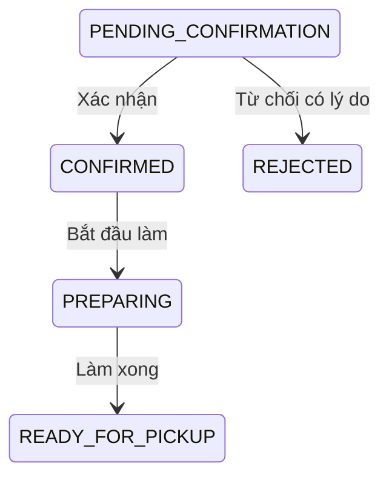
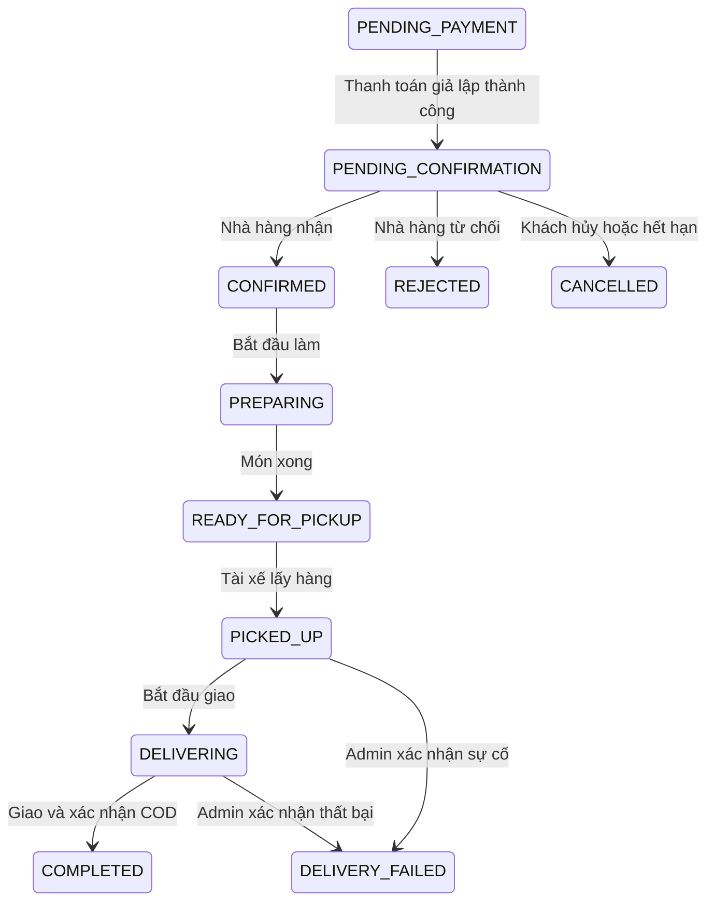

# Thiết kế API — Hệ thống Đặt và Giao đồ ăn

## 1. Kết luận kiểm tra và phạm vi

README đã có **mục 13: Hợp đồng REST API đề xuất** và **mục 14: Thiết kế WebSocket**. Trước lần bổ sung này chưa có tệp OpenAPI hoặc đặc tả đầy đủ các request/response của mã đang chạy.

Tài liệu này bổ sung hợp đồng tích hợp cho cả ứng dụng, đồng thời giữ rõ hai mức:

| Tài liệu | Phạm vi | Có gọi được hiện tại không? |
| --- | --- | --- |
| [openapi.yaml](openapi.yaml) | 32 thao tác HTTP trên 27 đường dẫn, đối chiếu các route Express hiện có; request, response, tham số, quyền, lỗi và SSE | Route đã có mã; không có nghĩa mọi nghiệp vụ đã hoàn tất hoặc mọi route đã được test |
| Mục 2–5 dưới đây | Giải thích API hiện tại và cách dùng | Có, khi backend và MongoDB hoạt động |
| Mục 6–10 dưới đây + README mục 13–14 | Thiết kế đích cho toàn bộ FR-1…FR-26: REST `/api/v1`, tài xế, payment, WebSocket, đối soát | **Chưa triển khai**; không gọi các URL này trên backend hiện tại |

Đây là thay đổi tài liệu thiết kế. Không tự thêm các route `/api/v1`, thay đổi database hay đổi hợp đồng frontend/backend hiện tại.

## 2. Quy ước API hiện tại

- Base URL phát triển: `http://localhost:5000/api`.
- JSON request/response: `Content-Type: application/json`; riêng stream là `text/event-stream`.
- JWT: `Authorization: Bearer <token>`. Chỉ `/auth/register` và `/auth/login` không cần đăng nhập. Ngay cả xem nhà hàng hiện cũng cần JWT.
- Vai trò: `customer`, `restaurant`, `driver`, `admin`; middleware lấy lại vai trò/trạng thái tài khoản từ database cho mỗi request.
- ID là MongoDB ObjectId dạng chuỗi 24 ký tự hex. Response model dùng `_id`; riêng user trả từ login dùng `id`.
- Tiền là **number nguyên VND** trong mã hiện tại. Thời điểm là ISO 8601 UTC; bộ lọc báo cáo nhận ngày `YYYY-MM-DD` theo Việt Nam, gồm cả ngày đầu và ngày cuối.
- Response giữ dạng hiện có: `{user}`, `{restaurant, menu}`, `{order}`, `{orders}`, `{message, ...}`. Chưa bọc đồng nhất `{data, meta}`.
- Lỗi thường là `{ "message": "Nội dung tiếng Việt" }`. Middleware tài khoản khóa có thêm `locked: true`, `reason`.
- Chỉ các danh sách admin có `page` (mặc định 1), `limit` (mặc định 10, tối đa 50), `q`, bộ lọc riêng; trả `{<danh sách>, total, page, pages}`. Quán công khai chưa phân trang; đơn quán tối đa 200; khiếu nại cá nhân tối đa 100.
- Không gửi `customerId`, `ownerId` để chọn người thao tác. Server suy từ JWT. Server quyết định giá, tổng tiền, hoa hồng và quyền đổi trạng thái.

### Mã HTTP hiện tại

| Mã | Ý nghĩa | Ví dụ |
| --- | --- | --- |
| 200 | Thành công hoặc trả kết quả yêu cầu cũ | Lấy hồ sơ; tạo đơn với key đã tồn tại |
| 201 | Tạo thành công | Đăng ký, thêm món, tạo đơn, tạo khiếu nại |
| 400 | Dữ liệu không hợp lệ | Thiếu địa chỉ, sai số lượng, từ chối không có lý do |
| 401 | Chưa/sai/hết hạn đăng nhập | Thiếu JWT |
| 403 | Sai vai trò hoặc tài khoản bị khóa | Khách vào API nhà hàng |
| 404 | Không tìm thấy tài nguyên được phép xem | Món của quán khác, khiếu nại của người khác |
| 409 | Xung đột điều kiện nghiệp vụ | Quán đóng, món hết, đơn đã được xử lý |
| 429 | Đạt giới hạn khiếu nại còn mở | Đã có 10 khiếu nại OPEN/IN_REVIEW |
| 500 | Lỗi server | Lỗi database hoặc exception chưa phân loại |

Một số controller cũ chưa kiểm tra kiểu dữ liệu đầy đủ, nên request sai kiểu có thể trả 500 thay vì 400. OpenAPI mô tả dữ liệu hợp lệ và các lỗi đã có; không khẳng định server đã có middleware validate theo OpenAPI.

## 3. Danh mục API đã có

Đường dẫn trong bảng dưới đều tính từ `/api`. Chi tiết schema, body và response nằm trong [OpenAPI hiện tại](openapi.yaml).

| Nhóm | Method + path | Quyền | Dữ liệu/chức năng chính |
| --- | --- | --- | --- |
| Xác thực | `POST /auth/register` | Public | `name, email, password, phone?, role?` → `message, userId` |
| Xác thực | `POST /auth/login` | Public | `email, password` → `token, user, message` |
| Hồ sơ | `GET /auth/profile` | Đăng nhập | `{user}` không có password |
| Hồ sơ | `PUT /auth/profile` | Đăng nhập | Sửa một phần `name, phone, gender, birthday, address` |
| Hồ sơ | `PUT /auth/change-password` | Đăng nhập | `currentPassword, newPassword` |
| Khám phá | `GET /restaurants` | Đăng nhập | Quán đã duyệt, chủ quán không bị khóa |
| Khám phá | `GET /restaurants/{id}` | Đăng nhập | `{restaurant, menu}` gồm cả món hết hàng |
| Nhà hàng | `GET /restaurants/mine` | Restaurant | Quán và menu của mình; chưa có quán → `restaurant: null` |
| Nhà hàng | `PUT /restaurants/mine` | Restaurant | Tạo/sửa quán; tạo mới cần tên, địa chỉ |
| Thực đơn | `POST /restaurants/mine/menu` | Restaurant | Thêm món: `name, price, category?, description?, available?` |
| Thực đơn | `PUT /restaurants/mine/menu/{itemId}` | Restaurant | Sửa một phần món của mình |
| Thực đơn | `DELETE /restaurants/mine/menu/{itemId}` | Restaurant | Xóa cứng món, giữ snapshot trong đơn cũ |
| Đơn hàng | `POST /orders` | Customer | Tạo đơn COD, bắt buộc header `Idempotency-Key` |
| Đơn nhà hàng | `GET /restaurants/mine/orders` | Restaurant | 200 đơn gần nhất của mình |
| Đơn nhà hàng | `PATCH /restaurants/mine/orders/{orderId}/status` | Restaurant | `status, reason?`; kiểm tra bước và chủ đơn |
| Thông báo | `GET /restaurants/mine/orders/stream` | Restaurant | SSE đơn hàng, JWT trong header |
| Báo cáo | `GET /restaurants/mine/report?from=...&to=...` | Restaurant | `{totals, orders, settlements}` |
| Khiếu nại | `POST /complaints` | Customer/Restaurant/Driver | `subject, description, category?, orderCode?` |
| Khiếu nại | `GET /complaints` | Customer/Restaurant/Driver | Hồ sơ của mình |
| Khiếu nại | `GET /complaints/{id}` | Customer/Restaurant/Driver | Chi tiết của mình, không trả assignedAdmin |
| Khiếu nại | `POST /complaints/{id}/messages` | Customer/Restaurant/Driver | `{text}`; chỉ hồ sơ còn mở, dưới 50 tin nhắn |
| Admin | `GET /admin/stats` | Admin | Số người dùng, quán, khiếu nại; chưa có doanh thu |
| Admin | `GET /admin/users` | Admin | `q, role, status, page, limit` |
| Admin | `GET /admin/users/{userId}` | Admin | `{user, audits}`; 20 audit mới nhất |
| Admin | `PATCH /admin/users/{userId}/lock` | Admin | `{reason}`; không tự khóa/khóa admin |
| Admin | `PATCH /admin/users/{userId}/unlock` | Admin | `{reason}` |
| Admin | `PATCH /admin/users/{userId}/role` | Admin | `{role, reason}`; không tự đổi vai trò |
| Admin | `GET /admin/restaurants` | Admin | `q, status, page, limit` |
| Admin | `PATCH /admin/restaurants/{id}/review` | Admin | `decision: approve/reject`, `reason?` |
| Admin | `GET /admin/complaints` | Admin | `q, status, page, limit` |
| Admin | `GET /admin/complaints/{id}` | Admin | Chi tiết, thông tin người gửi/người xử lý |
| Admin | `PATCH /admin/complaints/{id}` | Admin | `status?, resolution?, message?` |

## 4. Ví dụ hợp đồng hiện tại

ID, tài khoản và mã đơn dưới đây chỉ là ví dụ; thay bằng dữ liệu thật của môi trường thử. Token không được đưa vào URL hay commit vào tài liệu.

### 4.1. Đăng nhập

```http
POST /api/auth/login
Content-Type: application/json

{"email":"customer@example.test","password":"mat-khau-thu"}
```

```json
{
  "message": "Đăng nhập thành công",
  "token": "<JWT trả về từ server>",
  "user": {
    "id": "507f1f77bcf86cd799439011",
    "name": "Khách thử",
    "email": "customer@example.test",
    "role": "customer"
  }
}
```

Token hiện hết hạn sau 7 ngày. Chưa có refresh token, logout server hoặc thu hồi JWT khi đổi mật khẩu.

### 4.2. Tạo đơn COD

```http
POST /api/orders
Authorization: Bearer <JWT khách hàng>
Idempotency-Key: order-demo-0001
Content-Type: application/json

{
  "restaurantId": "507f1f77bcf86cd799439012",
  "items": [{"menuItem":"507f1f77bcf86cd799439013","quantity":2}],
  "address": "123 Đường thử nghiệm",
  "phone": "0901234567",
  "note": "Không cay"
}
```

Nếu món có giá 35.000 VND, response `201` có dạng (rút gọn các trường model):

```json
{
  "order": {
    "_id": "507f1f77bcf86cd799439014",
    "restaurant": "507f1f77bcf86cd799439012",
    "customer": "507f1f77bcf86cd799439011",
    "status": "PENDING_CONFIRMATION",
    "paymentMethod": "COD",
    "subtotal": 70000,
    "commissionAmount": 7000,
    "restaurantNetAmount": 63000,
    "items": [{"menuItem":"507f1f77bcf86cd799439013","name":"Cơm gà","unitPrice":35000,"quantity":2}]
  }
}
```

Tối đa 50 món khác nhau, mỗi món 1–99 phần. Quán phải mở, đã duyệt, chủ không bị khóa; món thuộc quán và còn hàng. Đơn chưa có phí giao, báo giá hay driver. Server bỏ qua tổng tiền client gửi.

Cùng khách và cùng key trả lại đơn cũ với `200`; index unique chống tạo trùng đồng thời. **Hiện chưa so sánh nội dung:** đổi body nhưng giữ key vẫn có thể nhận đơn cũ, thay vì lỗi `IDEMPOTENCY_CONFLICT` của thiết kế đích. Client chỉ dùng lại key để thử lại cùng yêu cầu.

### 4.3. Nhà hàng xử lý đơn

```http
PATCH /api/restaurants/mine/orders/507f1f77bcf86cd799439014/status
Authorization: Bearer <JWT nhà hàng>
Content-Type: application/json

{"status":"REJECTED","reason":"Quán đã hết nguyên liệu"}
```



Response `200` là `{order}` sau cập nhật. Đúng quán và đúng trạng thái trước được kiểm tra trong cùng một lệnh update. Nếu hai người xác nhận/từ chối đồng thời, chỉ một thao tác thắng; thao tác còn lại nhận `409`. Nhà hàng không được đặt `COMPLETED`.

### 4.4. Nhận đơn thời gian thực

`GET /api/restaurants/mine/orders/stream` trả `Content-Type: text/event-stream`:

```text
data: {"orders":[]}

: heartbeat

```

Server kiểm tra database mỗi 2 giây, gửi snapshot tối đa 200 đơn khi dữ liệu thay đổi. Lỗi truy vấn phát `event: unavailable`, `data: {}` rồi đóng kết nối. Client dùng authenticated `fetch` vì `EventSource` mặc định không gắn được Bearer header; không đưa JWT vào query string. Khi nối lại, nhận snapshot mới; chưa có event ID/Last-Event-ID để replay từng sự kiện. Đây là SSE đã có; WebSocket ở mục 9 là thiết kế tương lai.

### 4.5. Doanh thu và đối soát

`GET /api/restaurants/mine/report?from=2026-10-01&to=2026-10-31`:

```json
{
  "totals": {"count":0,"subtotal":0,"commissionAmount":0,"restaurantNetAmount":0},
  "orders": [],
  "settlements": []
}
```

- Chỉ đơn `COMPLETED`; `totals/orders` lọc `completedAt`, lịch sử `settlements` lọc `settlement.finalizedAt`.
- Ngày 01/10 bắt đầu ở `2026-09-30T17:00:00Z`; hết ngày 31/10 ở mốc không bao gồm `2026-10-31T17:00:00Z`.
- `restaurantNetAmount` là quyền hưởng, không đồng nghĩa đã chi tiền. `paidAt: null` ở mục lịch sử nghĩa chưa ghi nhận chi giả lập.
- Chưa có API hoàn tất giao hàng, chốt kỳ hay chi đối soát trong mã hiện tại; không tạo số liệu mẫu để giả làm dữ liệu vận hành.

## 5. Cách mở và kiểm tra đặc tả

1. Mở [openapi.yaml](openapi.yaml) bằng Swagger Editor hoặc nhập tệp vào Postman dưới dạng OpenAPI 3.0.
2. Chọn server phát triển, đăng nhập qua `/auth/login`, lấy token rồi cấu hình Bearer Auth/Authorize. Chỉ dùng tài khoản thử.
3. Gửi các request trên backend đang chạy; thay ID mẫu bằng ID trong database.
4. Với SSE, dùng `fetch` hỗ trợ stream hoặc `curl -N` kèm Bearer header; một số trình nhập OpenAPI không hiển thị từng frame trực tiếp.

### Xem trực tiếp trong backend bằng Swagger UI

Sau khi lấy mã nguồn mới về máy:

```bash
cd backend
npm ci
npm run dev
```

Khi MongoDB kết nối thành công và server chạy, mở `http://localhost:5000/api-docs/` trong trình duyệt (thay 5000 nếu bạn cấu hình PORT khác). Mở `/api` cũng tự chuyển đến trang tài liệu.

- Mở nhóm **Auth**, chọn `POST /auth/login` → **Try it out** → nhập email/mật khẩu tài khoản thử → **Execute**.
- Sao chép giá trị `token` trong response, bấm **Authorize**, dán riêng token (không thêm chữ `Bearer`), bấm **Authorize** rồi **Close**.
- Mở API cần thử, bấm **Try it out**, điền tham số/body và **Execute**. API vẫn kiểm tra JWT và vai trò bình thường; gọi tạo/sửa/xóa sẽ thay đổi dữ liệu thật trong database đang cấu hình.
- UI không giữ token qua lần tải lại trang và không gọi dịch vụ validator ngoài. Tài nguyên Swagger được phục vụ từ package local.
- UI dùng server tương đối `/api`, nên Try it out gọi đúng host/port đang mở. Tải JSON tại `/api-docs/openapi.json`; tệp YAML vẫn có thể nhập riêng vào Swagger Editor/Postman.
- Endpoint SSE là kết nối dài hạn; dùng `fetch` hoặc `curl -N` để quan sát frame, tránh chờ một JSON response kết thúc trong Swagger.

Đây là trang tài liệu của backend trên máy đang chạy mã nguồn mới. Xuất bản môi trường cloud không tự cập nhật GitHub hoặc thư mục dự án trên máy cá nhân.

## 6. Thiết kế đích cho toàn ứng dụng — CHƯA TRIỂN KHAI

### 6.1. Quy ước đích

- Base `/api/v1`; giữ các endpoint `/api` hiện tại trong giai đoạn chuyển tiếp, không đổi ngầm frontend.
- UUID dạng opaque cho ID khi chuyển schema PostgreSQL; không để client phụ thuộc kiểu ObjectId. Trường thống nhất là `id`.
- Tiền dùng chuỗi số nguyên VND (`"70000"`) để tránh giới hạn số nguyên JavaScript khi dữ liệu lớn; không trộn number của API cũ trong cùng hợp đồng v1.
- Thành công `{data, meta?}`; lỗi `{error: {code, message, details?}, requestId}`.
- Danh sách nhận `page>=1`, `limit=20` mặc định, tối đa 100; trả `meta: {page, limit, total, pages}`. Thứ tự ổn định `createdAt DESC, id DESC`; GPS/sự kiện dùng sequence/cursor riêng.
- Thời điểm ISO 8601 UTC; kỳ nghiệp vụ dùng timezone `Asia/Ho_Chi_Minh`, khoảng `[periodStart, periodEnd)`.
- API action thay đổi đơn/tiền cần key chống lặp và `expectedVersion` khi dựa vào trạng thái trước. Mọi update nghiệp vụ tăng version.
- Cùng chủ thể + method + route + `Idempotency-Key` và cùng canonical request hash trả lại kết quả đã lưu. Khác body trả `409 IDEMPOTENCY_CONFLICT`. Khóa/unique record phải nằm cùng transaction với nghiệp vụ; giữ record ít nhất bằng thời hạn retry của nghiệp vụ, khoản tiền giữ reference lâu dài.
- JWT access ngắn hạn (đề xuất 15 phút), refresh token xoay vòng và lưu hash server; logout/khóa/đổi mật khẩu có cơ chế thu hồi. Trình duyệt dùng refresh cookie `HttpOnly`, `Secure`, `SameSite` phù hợp cùng CSRF protection nếu cross-site; không lưu refresh token trong localStorage.
- Đăng ký public chỉ tạo `customer`. Nhà hàng/tài xế qua hồ sơ đối tác và admin duyệt; admin chỉ được cấp bởi quy trình quản trị có audit.

### 6.2. Lỗi đích

```json
{
  "error": {
    "code": "INVALID_ORDER_TRANSITION",
    "message": "Đơn không còn ở trạng thái chờ xác nhận",
    "details": {"currentStatus":"CONFIRMED","expectedStatus":"PENDING_CONFIRMATION"}
  },
  "requestId": "req-example-01"
}
```

| HTTP | Mã máy đọc | Điều kiện |
| --- | --- | --- |
| 400 | VALIDATION_ERROR | Sai kiểu, phạm vi, trường bắt buộc |
| 401/403 | UNAUTHENTICATED / FORBIDDEN | Sai phiên/quyền/đối tượng |
| 404 | RESOURCE_NOT_FOUND | Không tồn tại hoặc không được phép biết đối tượng tồn tại |
| 409 | IDEMPOTENCY_CONFLICT / VERSION_CONFLICT | Trùng key khác body, phiên bản cũ |
| 409 | QUOTE_EXPIRED / PRICE_CHANGED / ITEM_UNAVAILABLE / RESTAURANT_UNAVAILABLE | Không thể checkout theo dữ liệu cũ |
| 409 | INVALID_ORDER_TRANSITION / ORDER_NOT_CANCELLABLE | Sai bước hoặc không thể hủy |
| 409 | OFFER_EXPIRED / ORDER_ALREADY_ASSIGNED / DRIVER_BUSY | Đề nghị cuốc hết hiệu lực hoặc tranh chấp |
| 409 | LOCATION_REQUIRED / LOCATION_STALE | Không có GPS đủ mới |
| 409 | PAYMENT_STATE_CONFLICT / REFUND_LIMIT_EXCEEDED | Sai trạng thái hoặc số tiền |
| 409 | SETTLEMENT_ALREADY_FINALIZED / ALREADY_SETTLED | Chốt/ghi nhận trùng |
| 429 | RATE_LIMITED | Giới hạn tần suất; trả Retry-After khi xác định được |
| 500/503 | INTERNAL_ERROR / DEPENDENCY_UNAVAILABLE | Lỗi server/dịch vụ phụ thuộc; không lộ stack trace |

## 7. Nhóm API đích và request/response chính

Các path trong mục này tính từ `/api/v1`; các tên schema ở đây mô tả thiết kế, không phải schema response hiện tại trong OpenAPI. `?` đánh dấu trường không bắt buộc. Mọi response thành công đều bọc `data`.

### 7.1. Auth, hồ sơ và khám phá — FR-1, FR-2

| Method + endpoint | Quyền | Request/query | Response chính |
| --- | --- | --- | --- |
| `POST /auth/register` | Public | `name, email, password, phone?`; không nhận role | `user{id, role: customer}`; 201 |
| `POST /auth/login` | Public | `email, password` | accessToken, expiresIn; refresh cookie |
| `POST /auth/refresh` | Refresh cookie hợp lệ | Cookie + CSRF theo cấu hình | Access token mới, xoay refresh |
| `POST /auth/logout` | Chủ phiên | Refresh cookie | 204, thu hồi phiên |
| `GET/PATCH /me` | Đăng nhập | PATCH: `name?, phone?, gender?, birthday?` | Hồ sơ mình, không có password/hash |
| `GET/POST /me/addresses` | Đăng nhập | POST: `label, address, latitude, longitude, isDefault?` | Danh sách/địa chỉ đã tạo |
| `PATCH/DELETE /me/addresses/{id}` | Chủ địa chỉ | PATCH: các trường địa chỉ cần đổi | Địa chỉ cập nhật/204 |
| `POST /partner-applications` | Customer | `type: restaurant/driver, legalName, phone, address, ...` | Hồ sơ PENDING; không tự cấp role |
| `GET /partner-applications/me` | Chủ hồ sơ | Phân trang | Hồ sơ và lý do duyệt/từ chối |
| `GET /restaurants` | Public | `q?, area?, cuisineType?, minRating?, lat?, lng?, page?, limit?` | Quán approved, giờ mở, điểm; chỉ tính khoảng cách nếu có tọa độ |
| `GET /restaurants/{id}` | Public | ID | Thông tin quán công khai |
| `GET /restaurants/{id}/menu` | Public | `categoryId?, available?, page?, limit?` | Món hiển thị và giá hiện hành |
| `GET /cuisine-types` | Public | Không | Danh mục loại món |

### 7.2. Giỏ, quote, đơn, payment, review — FR-3…FR-9

| Method + endpoint | Quyền | Request/query | Response chính |
| --- | --- | --- | --- |
| `GET /cart` | Customer | Không | Giỏ của mình, một quán |
| `POST /cart/items` | Customer | `menuItemId, quantity` | Giỏ mới; khác quán cần xác nhận xóa giỏ trước |
| `PATCH/DELETE /cart/items/{id}` | Chủ giỏ | PATCH: `quantity` 1–99 | Giỏ/204 |
| `DELETE /cart` | Chủ giỏ | Không | 204 |
| `POST /checkout/quote` | Customer | `addressId, paymentMethod: COD/MOCK_PREPAID` | Quote có snapshot giá, tọa độ, phí giao, expiresAt |
| `POST /orders` | Customer | `quoteId, note?`; Idempotency-Key | Order từ quote còn hạn; 201/200 retry |
| `GET /orders` | Customer | `status?, from?, to?, page?, limit?` | Lịch sử của mình |
| `GET /orders/{id}` | Chủ đơn | Không | Snapshot đơn, timeline, payment, dispatch; dữ liệu liên hệ/GPS theo trạng thái |
| `POST /orders/{id}/cancel` | Chủ đơn | `reason, expectedVersion`; key | Chỉ trước xác nhận; hủy/hoàn giả lập nếu cần |
| `POST /orders/{id}/payment-attempts` | Chủ đơn | `expectedVersion`; key | Attempt còn hiệu lực, không thu hai lần |
| `GET /orders/{id}/payment` | Chủ đơn | Không | Trạng thái tiền và số tiền đã thu/hoàn |
| `POST /sandbox/payment-attempts/{id}/resolve` | Chủ giao dịch, chỉ sandbox | `outcome: success/fail`; key | Kết quả giả lập được server xử lý; không mở ở production |
| `POST /orders/{id}/review` | Chủ đơn COMPLETED | `restaurantRating:1..5, driverRating?:1..5, comment?`; key | Một review/đơn; unique constraint |
| `GET /restaurants/{id}/reviews` | Public | Phân trang | Chỉ review đã duyệt |
| `GET /me/reviews` | Customer | Phân trang | Review của mình |

Quote đề xuất:

```json
{
  "data": {
    "id": "quote-example-01",
    "restaurantId": "restaurant-example-01",
    "items": [{"menuItemId":"item-example-01","name":"Cơm gà","unitPrice":"35000","quantity":2}],
    "subtotal": "70000",
    "deliveryFee": "15000",
    "totalAmount": "85000",
    "commissionAmount": "7000",
    "restaurantNetAmount": "63000",
    "driverEarning": "15000",
    "pricingVersion": "demo-v1",
    "expiresAt": "2026-10-31T08:05:00Z"
  }
}
```

Phí theo README: 15.000 VND cho ≤2 km, mỗi km vượt làm tròn lên cộng 5.000 VND; hoa hồng 10% tiền món. Quote lưu khoảng cách và giá; backend kiểm tra lại quán/món lúc tạo đơn. Payment/refund có state machine riêng; client không được đặt PAID/REFUNDED trực tiếp. Callback/worker xác minh nguồn, chống trùng reference, ghi sổ và trạng thái trong transaction.

### 7.3. Nhà hàng — FR-10…FR-14

| Method + endpoint | Quyền | Request/query | Response chính |
| --- | --- | --- | --- |
| `GET/PATCH /restaurant/profile` | Restaurant | PATCH: thông tin quán, tọa độ, isOpen, expectedVersion | Quán của mình; không tự duyệt |
| `GET/PUT /restaurant/opening-hours` | Restaurant | Các ngày trong tuần, giờ địa phương, ngày nghỉ | Lịch mở cửa hợp lệ |
| `GET/POST /restaurant/menu-categories` | Restaurant | POST: `name, sortOrder?` | Danh mục quán |
| `PATCH/DELETE /restaurant/menu-categories/{id}` | Chủ danh mục | PATCH: tên/thứ tự; DELETE phải xử lý món còn tham chiếu | Danh mục/204 hoặc 409 |
| `GET/POST /restaurant/menu-items` | Restaurant | POST: `name, price, categoryId?, description?, available?` | Menu/món mới |
| `PATCH/DELETE /restaurant/menu-items/{id}` | Chủ món | PATCH: trường cần sửa; DELETE soft delete | Món/204; không sửa snapshot đơn |
| `GET /restaurant/orders` | Restaurant | `status?, from?, to?, page?, limit?` | Đơn thuộc quán |
| `GET /restaurant/orders/{id}` | Chủ quán của đơn | Không | Chi tiết có liên hệ phục vụ giao nhận |
| `POST /restaurant/orders/{id}/accept` | Chủ quán của đơn | `expectedVersion`; key | CONFIRMED |
| `POST /restaurant/orders/{id}/reject` | Chủ quán của đơn | `reason, expectedVersion`; key | REJECTED; phát xử lý refund nếu cần |
| `POST /restaurant/orders/{id}/start-preparing` | Chủ quán của đơn | `expectedVersion`; key | PREPARING |
| `POST /restaurant/orders/{id}/ready` | Chủ quán của đơn | `expectedVersion`; key | READY_FOR_PICKUP |
| `GET /restaurant/reports` | Restaurant | `from, to, groupBy: day/week` | Đơn COMPLETED, subtotal, commission, net; khoản giữ lại riêng |
| `GET /restaurant/settlements` | Restaurant | `from?, to?, status?, page?, limit?` | Kỳ của mình; không nhầm chốt kỳ với đã chi |
| `GET /restaurant/settlements/{id}` | Chủ khoản đối soát | Không | Chi tiết đơn, quyền hưởng, điều chỉnh, giữ lại, transfer giả lập |

### 7.4. Tài xế và điều phối — FR-15…FR-19, FR-21

| Method + endpoint | Quyền | Request/query | Response chính |
| --- | --- | --- | --- |
| `GET/PATCH /driver/profile` | Driver | PATCH: thông tin hồ sơ được phép | Hồ sơ mình, trạng thái duyệt |
| `PUT /driver/availability` | Driver đã duyệt | `online: boolean, expectedVersion` | Trạng thái; online cần GPS đủ mới, không bị khóa |
| `POST /driver/location` | Driver online/có cuốc | `latitude[-90,90], longitude[-180,180], accuracy>=0, sequence>=1` | receivedAt, accepted; ID tài xế lấy từ JWT |
| `GET /driver/offers` | Driver | Không | Offer của mình chưa hết hạn; thông tin giao tối thiểu |
| `POST /driver/offers/{id}/accept` | Chủ offer | `expectedVersion`; key | Assignment duy nhất nếu còn hạn, tài xế rảnh |
| `POST /driver/offers/{id}/reject` | Chủ offer | `reason?`; key | Offer đã đóng |
| `GET /driver/jobs` | Driver | `status?, page?, limit?` | Cuốc của mình |
| `GET /driver/jobs/{id}` | Driver được gán | Không | Địa chỉ/liên hệ cần thiết, snapshot tiền COD |
| `POST /driver/jobs/{id}/pick-up` | Driver đang được gán | `expectedVersion`; key | PICKED_UP, đơn trước đó READY_FOR_PICKUP |
| `POST /driver/jobs/{id}/start-delivery` | Driver đang được gán | `expectedVersion`; key | DELIVERING |
| `POST /driver/jobs/{id}/complete` | Driver đang được gán | `expectedVersion, codCollectedAmount?`; key | COMPLETED; COD phải xác nhận đúng totalAmount |
| `POST /driver/jobs/{id}/report-issue` | Driver đang được gán | `type, description`; key | Incident; không tự nhảy COMPLETED |
| `GET /driver/earnings` | Driver | `from, to` | Công giao, COD thu hộ, phải nộp/được nhận tách riêng |
| `GET /driver/settlements` | Driver | Phân trang/lọc ngày | Kỳ của mình |
| `GET /driver/settlements/{id}` | Chủ khoản đối soát | Không | Chi tiết và chiều chuyển tiền |
| `GET /driver/reviews` | Driver | Phân trang | Đánh giá về mình |

Offer hết hạn và accept phải được kiểm tra cùng transaction/khóa; không dựa vào countdown trình duyệt. Unique/partial index đảm bảo một assignment active cho một đơn và một cuốc active cho tài xế. GPS cũ/sequence cũ không được thay GPS mới. `receivedAt` do server cấp; vị trí mô phỏng có nhãn `source: simulation`, chỉ môi trường demo được cấp quyền.

### 7.5. Admin, đối soát, khiếu nại, thông báo — FR-20, FR-23…FR-26

| Method + endpoint | Quyền | Request/query | Response chính |
| --- | --- | --- | --- |
| `GET /admin/users` | Admin | `q?, role?, status?, page?, limit?` | Danh sách không chứa hash/password |
| `POST /admin/users/{id}/lock`, `/unlock` | Admin | `reason, expectedVersion`; key | Trạng thái tài khoản + audit |
| `GET /admin/partner-applications` | Admin | `type?, status?, page?, limit?` | Hồ sơ đối tác |
| `POST /admin/partner-applications/{id}/approve`, `/reject` | Admin | `reason?, expectedVersion`; key; reject cần reason | Hồ sơ và role/quyền được cấp có audit |
| `GET /admin/orders` | Admin | Bộ lọc trạng thái/ngày/dispatch, phân trang | Danh sách vận hành |
| `GET /admin/orders/{id}` | Admin | Không | Đơn, timeline, payment, assignment, incident |
| `POST /admin/orders/{id}/redispatch` | Admin | `reason, expectedVersion`; key | Tác vụ tìm lại trước pickup |
| `POST /admin/orders/{id}/assign-driver` | Admin | `driverId, reason, expectedVersion`; key | Assignment vẫn phải thỏa điều kiện rảnh/quyền |
| `POST /admin/orders/{id}/cancel` | Admin | `reason, expectedVersion`; key | Hủy ngoại lệ trước pickup; refund nếu cần |
| `POST /admin/orders/{id}/confirm-delivery-failure` | Admin | `reason, incidentId, expectedVersion`; key | DELIVERY_FAILED; không xóa nghĩa vụ tiền |
| `GET/POST /admin/settlements` | Admin | POST: `periodStart, periodEnd, timezone`; key | Kỳ DRAFT, snapshot đơn đủ điều kiện |
| `GET /admin/settlements/{id}` | Admin | Không | Khoản từng bên, đơn giữ lại, tổng/chiều chuyển |
| `POST /admin/settlements/{id}/finalize` | Admin | `expectedVersion, reason`; key | FINALIZED trong transaction, không đồng nghĩa PAID |
| `POST /admin/settlement-items/{id}/transfers` | Admin | `amount, direction: PAY_OUT/COLLECT_IN, reference, reason`; key | Transfer giả lập; MVP chỉ toàn bộ khoản, từ chối phần lẻ |
| `POST /admin/financial-adjustments` | Admin | `partyType, partyId, sourceReference, amountSigned, reason`; key | Điều chỉnh có audit, áp vào kỳ tiếp theo |
| `GET /admin/reports` | Admin | `from, to, groupBy?` | Doanh số hoàn tất, hoa hồng, COD, lỗi/hoàn, hiệu suất |
| `GET /admin/audit-logs` | Admin | `actorId?, entityType?, entityId?, from?, to?, page?, limit?` | Nhật ký thao tác có quyền |
| `POST /admin/reviews/{id}/moderate` | Admin | `decision: hide/restore, reason, expectedVersion` | Review được xử lý có audit |
| `POST /complaints` | Customer/Restaurant/Driver | `category, subject, description, orderId? hoặc settlementItemId?` | Hồ sơ liên kết thật, server kiểm tra quyền |
| `GET /complaints`, `GET /complaints/{id}` | Người gửi | Danh sách: phân trang | Chỉ hồ sơ mình |
| `POST /complaints/{id}/messages` | Người gửi hồ sơ mở | `text`; key | Tin nhắn đã lưu |
| `GET /admin/complaints` | Admin | `status?, q?, assigneeId?, page?, limit?` | Hồ sơ cần xử lý |
| `GET /admin/complaints/{id}` | Admin | Không | Toàn bộ hồ sơ được phép xem |
| `PATCH /admin/complaints/{id}` | Admin | `assignedAdminId?, status?, resolution?, message?, expectedVersion` | Đóng cần kết luận; audit |
| `GET /notifications` | Đăng nhập | `unreadOnly?, page?, limit?` | Thông báo của mình |
| `POST /notifications/{id}/read` | Chủ thông báo | Không | readAt; lặp lại không tạo tác dụng mới |

## 8. Trạng thái và tính nhất quán — FR-22

Luồng đích phải theo README mục 8, không cung cấp API để client tùy ý đặt status:



COD tạo thẳng `PENDING_CONFIRMATION`; trả trước đi qua `PENDING_PAYMENT`. Nhánh hủy ngoại lệ trước pickup, timeout và refund theo README; `dispatchStatus` tách khỏi `order.status`. Không reset các trạng thái kết thúc để sửa số liệu.

Các bất biến cần bảo vệ bằng database/transaction:

1. Snapshot giá/tiền/địa chỉ tại lúc đặt, không đọc giá menu mới để sửa đơn cũ.
2. Compare-and-set status/version; trạng thái, history, ledger và outbox commit cùng nhau.
3. Một đơn chỉ một tài xế active; tài xế chỉ một cuốc active. Admin cũng tuân thủ.
4. Payment/refund có reference unique, số hoàn không vượt số đã thu; callback lặp/đảo thứ tự không thu/hoàn thêm.
5. Đối soát chỉ chọn COMPLETED, theo completedAt; COD thiếu xác nhận/tranh chấp giữ lại có lý do. Unique liên kết order + partyType + partyId ngăn tính hai kỳ.
6. Nhà hàng hưởng subtotal − commission; tài xế hưởng deliveryFee. Với COD, công giao và tiền thu hộ tách riêng. `totalAmount = restaurantNetAmount + driverEarning + commissionAmount`.
7. Finalize khác transfer; transfer có reference unique, nhãn giả lập, chiều thu/chi và audit. Điều chỉnh sau chốt không sửa snapshot kỳ cũ.

## 9. WebSocket và quyền dữ liệu — FR-5, FR-6, FR-11, FR-17, FR-25

**Thiết kế chưa triển khai:** handshake bằng access token, backend xác thực lại khi reconnect; tự suy room, không nhận room tùy ý từ client.

| Room | Quyền |
| --- | --- |
| `user:{id}` | Chính người dùng |
| `restaurant:{id}` | Chủ quán hợp lệ |
| `driver:{id}` | Chính tài xế |
| `order:{id}` | Chủ đơn/nhà hàng/tài xế đang được gán/admin theo dữ liệu được phép |

| Event | Hướng | Payload chính |
| --- | --- | --- |
| `order.created` | Server → khách/nhà hàng | eventId, orderId, version, occurredAt |
| `order.status.changed` | Server → bên có quyền | eventId, orderId, status, dispatchStatus, version, occurredAt |
| `driver.offer.created` | Server → một tài xế | eventId, offerId, expiresAt, dữ liệu đề nghị tối thiểu |
| `driver.offer.closed` | Server → tài xế | eventId, offerId, reason, occurredAt |
| `order.driver.assigned` | Server → bên có quyền | eventId, orderId, driver được phép xem, version |
| `driver.location.update` | Driver → server | latitude, longitude, accuracy, sequence; không nhận driverId |
| `order.driver.location` | Server → khách đang có đơn giao/admin được phép | orderId, latitude, longitude, sequence, source, receivedAt |
| `notification.created` | Server → chủ thông báo | eventId, notificationId, title, readAt |

Không broadcast GPS đầy đủ cho mọi thành viên room đơn. Tài xế mất assignment bị bỏ quyền; dữ liệu liên hệ/GPS chỉ giữ trong thời gian nghiệp vụ cần thiết. Worker đọc outbox sau commit, retry với eventId ổn định; client loại trùng và bỏ version/sequence cũ. Reconnect phải GET lại đơn/thông báo; REST fallback 3–5 giây. Không xem socket là nguồn lưu trạng thái.

## 10. Đối chiếu yêu cầu và việc triển khai tiếp

| Yêu cầu | Hợp đồng thiết kế | Hiện trạng |
| --- | --- | --- |
| FR-1 | Auth/profile | Có login/register/profile; chưa refresh/revoke, cần chặn public role admin |
| FR-2 | Restaurants/search/menu | Có list/detail; chưa đủ bộ lọc |
| FR-3 | Cart/quote/orders | Có tạo đơn COD tối thiểu; chưa cart server/quote |
| FR-4 | Payment attempts/sandbox | Chưa có |
| FR-5…FR-9 | Order detail/tracking/cancel/reviews/history | Chưa đầy đủ; chưa có GET order cho khách |
| FR-10 | Menu/categories | Có menu CRUD/còn hàng; category còn là chuỗi, DELETE cứng |
| FR-11 | Event order.created | Có SSE snapshot cho nhà hàng; chưa WebSocket/outbox |
| FR-12…FR-13 | Accept/reject/prepare/ready | Có API PATCH status kiểm tra đúng bước |
| FR-14 | Reports/settlements | Có báo cáo và đọc kỳ lưu trong đơn; chưa chốt/chi kỳ |
| FR-15…FR-19 | Driver/location/offers/jobs/earnings | Chưa có |
| FR-20 | Users/partner review | Có users/quán; hồ sơ duyệt tài xế chưa có |
| FR-21 | Dispatch/assignment | Chưa có |
| FR-22 | State machine/history | Có phần chế biến; chưa trọn vòng đời và transaction đa bảng |
| FR-23 | Settlement/finalize/transfers | Chưa có module tạo/chốt/chi |
| FR-24 | Complaints/adjustments | Có khiếu nại/trả lời/xử lý; orderCode nhập tay, chưa liên kết khoản đối soát |
| FR-25 | Notifications/socket/outbox | Có SSE nhà hàng; chưa hệ thống thông báo tổng quát |
| FR-26 | Admin reports | Có thống kê tài khoản/quán/khiếu nại; chưa doanh thu/hiệu suất |

Lộ trình tích hợp: chốt schema/OpenAPI v1 → auth/phân quyền → cart/quote/order/payment → vòng đời nhà hàng/tài xế/dispatch → WebSocket/outbox → đối soát/điều chỉnh/báo cáo. Chuyển dữ liệu và frontend có adapter/phiên bản, không đổi định dạng tiền hoặc ID trong API cũ một cách âm thầm.

Bộ kiểm thử nghiệm thu hợp đồng cần gồm: schema request/response, quyền từng vai trò/ID của người khác, key lặp khác body, trạng thái đồng thời, offer hết hạn, callback lặp, mốc ngày UTC+7, chốt/chi lặp và reconnect sự kiện. Các kiểm thử này là tiêu chí cho API đích, không được coi là đã chạy chỉ vì tài liệu tồn tại.
